# RoboShop Infrastructure on AWS EKS

Enterprise-grade DevSecOps Kubernetes Platform for the **RoboShop** e-commerce microservices ecosystem. This repository contains the complete modular Terraform infrastructure, Kubernetes manifests, Helm charts, and operational runbooks for running 10+ microservices on Amazon Elastic Kubernetes Service (EKS) with zero-downtime upgrades, secure networking, and high availability.

---

## Architecture Overview

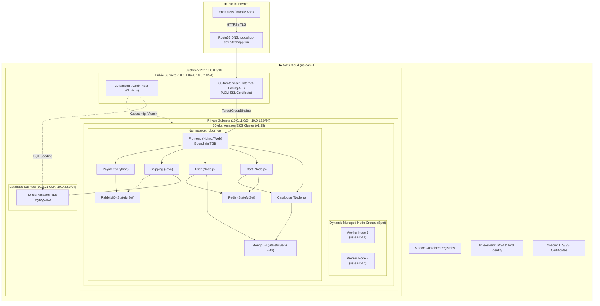

---

## Infrastructure Modules & Dependency Order

The infrastructure is broken down into isolated Terraform state modules to minimize blast radius and ensure granular lifecycle management:

| Sequence | Module | Description | Key Outputs / Exported SSM Parameters |
| :--- | :--- | :--- | :--- |
| **01** | `00-vpc` | 3-tier custom VPC (Public, Private, Database subnets) across 2 AZs | `/roboshop/dev/vpc_id`, subnet IDs |
| **02** | `10-sg` | Core Security Groups (Bastion, EKS Node, Control Plane, ALB, RDS) | Security Group IDs |
| **03** | `20-sg-rules` | Decoupled cross-referencing Security Group ingress/egress rules | Resolves cyclic dependency deadlocks |
| **04** | `30-bastion` | Administrative Bastion EC2 host with automated tooling | Public IP, SSH access |
| **05** | `31-cicd-tools` | Jenkins, SonarQube, Nexus, and tools workstation | Tooling instance endpoints |
| **06** | `40-rds` | Managed Amazon RDS MySQL instance for Shipping service | RDS endpoint, secret credentials |
| **07** | `50-ecr` | Amazon Elastic Container Registry repositories for microservices | ECR Repository URIs |
| **08** | `60-eks` | Amazon EKS Cluster with dynamic Blue/Green nodegroups | Cluster endpoint, OIDC ARN |
| **09** | `61-eks-iam` | IAM Roles for Service Accounts (EBS CSI, AWS Load Balancer Controller) | IRSA role ARNs |
| **10** | `70-acm` | ACM SSL/TLS wildcard certificate with Route53 DNS validation | Certificate ARN |
| **11** | `80-frontend-alb` | Internet-facing ALB, HTTPS listener, Route53 Alias, Target Group | ALB DNS, Target Group ARN |

---

## Step-by-Step Cluster Setup & Proof of Work

### 1. Bastion Authentication & Cluster Access

Log in to the Bastion host and configure AWS credentials and Kubeconfig to connect to EKS:

```bash
# Verify AWS credentials
aws configure list

# Generate Kubeconfig for EKS
aws eks update-kubeconfig --region us-east-1 --name roboshop-dev

# Confirm cluster nodes are Ready
kubectl get nodes -o wide
```

#### Proof of Work:
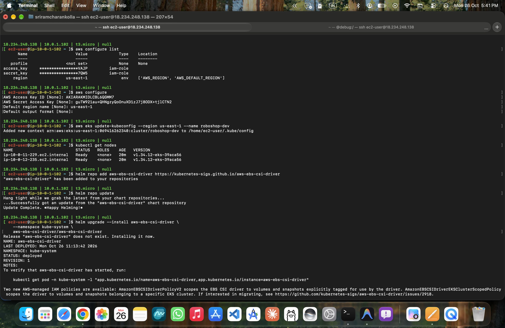

---

### 2. Storage Setup: AWS EBS CSI Driver & StorageClass

EKS requires the Amazon EBS CSI Driver to dynamically provision persistent EBS volumes for stateful databases (MongoDB, RabbitMQ).

#### Install EBS CSI Driver via Helm:
```bash
helm repo add aws-ebs-csi-driver https://kubernetes-sigs.github.io/aws-ebs-csi-driver
helm repo update

helm upgrade --install aws-ebs-csi-driver \
    --namespace kube-system \
    aws-ebs-csi-driver/aws-ebs-csi-driver
```

#### Proof of Work:
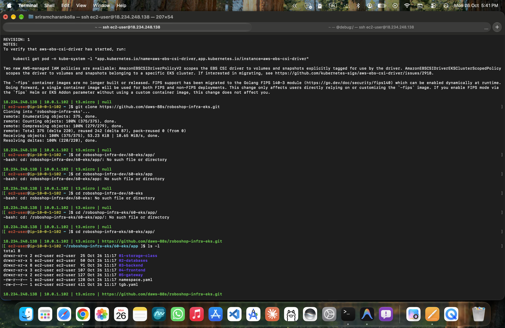

#### Create Namespace & Custom StorageClass:
We define a custom StorageClass (`roboshop-ebs`) using `volumeBindingMode: WaitForFirstConsumer` so EBS volumes are created in the exact Availability Zone where the pod is scheduled.

```bash
# 1. Create roboshop namespace
kubectl apply -f /home/ec2-user/roboshop-infra-eks/60-eks/app/namespace.yaml

# 2. Create StorageClass
kubectl apply -f /home/ec2-user/roboshop-infra-eks/60-eks/app/01-storage-class/ebs-sc.yaml

# 3. Verify StorageClass
kubectl get sc
```

#### Proof of Work:
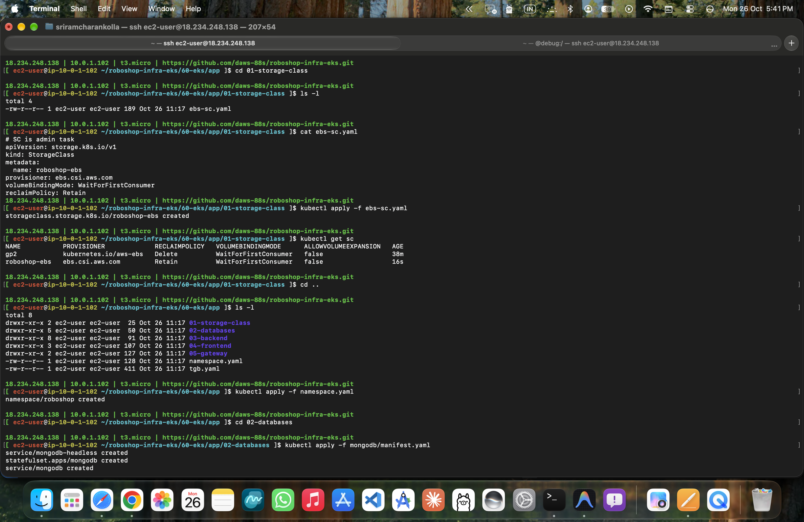

---

### 3. Stateful Database Deployment & Schema Initialization

Deploy the stateful datastores and populate the relational tables in RDS MySQL.

#### Deploy MongoDB, Redis, and RabbitMQ:
```bash
cd /home/ec2-user/roboshop-infra-eks/60-eks/app/02-databases
kubectl apply -f mongodb/manifest.yaml
kubectl apply -f redis/manifest.yaml
kubectl apply -f rabbitmq/manifest.yaml
```

#### Proof of Work:
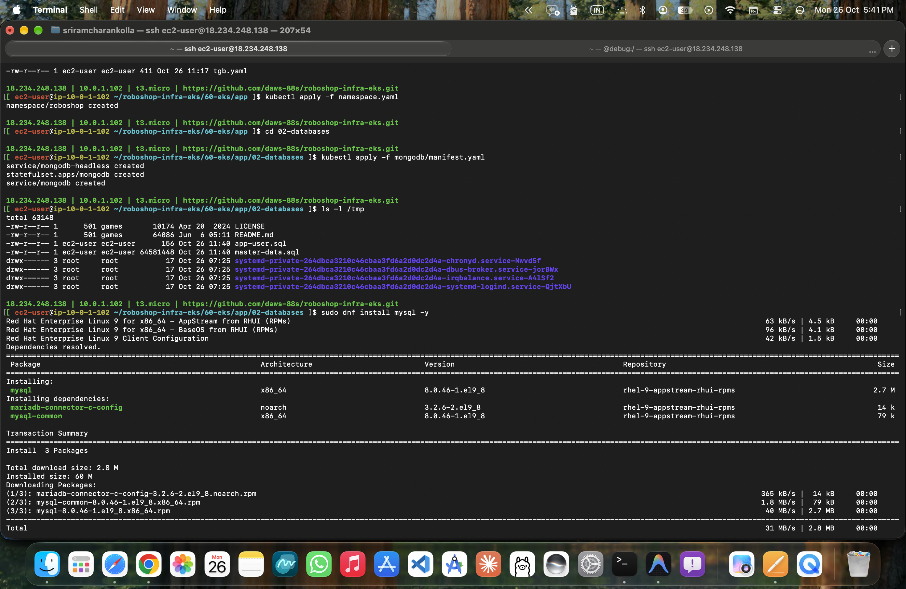

#### Initialize RDS MySQL Database from Bastion:
Load master data and create application user grants for the Shipping microservice:

```bash
# Install MySQL CLI client
sudo dnf install mysql -y

# Retrieve RDS endpoint from SSM Parameter Store
RDS_ENDPOINT=$(aws ssm get-parameter --name /roboshop/dev/rds_endpoint --query Parameter.Value --output text)

# Load master schema and records
mysql -h $RDS_ENDPOINT -u root -pRoboShop#123 < /tmp/master-data.sql

# Load user credentials and grants
mysql -h $RDS_ENDPOINT -u root -pRoboShop#123 < /tmp/app-user.sql
```

#### Proof of Work:
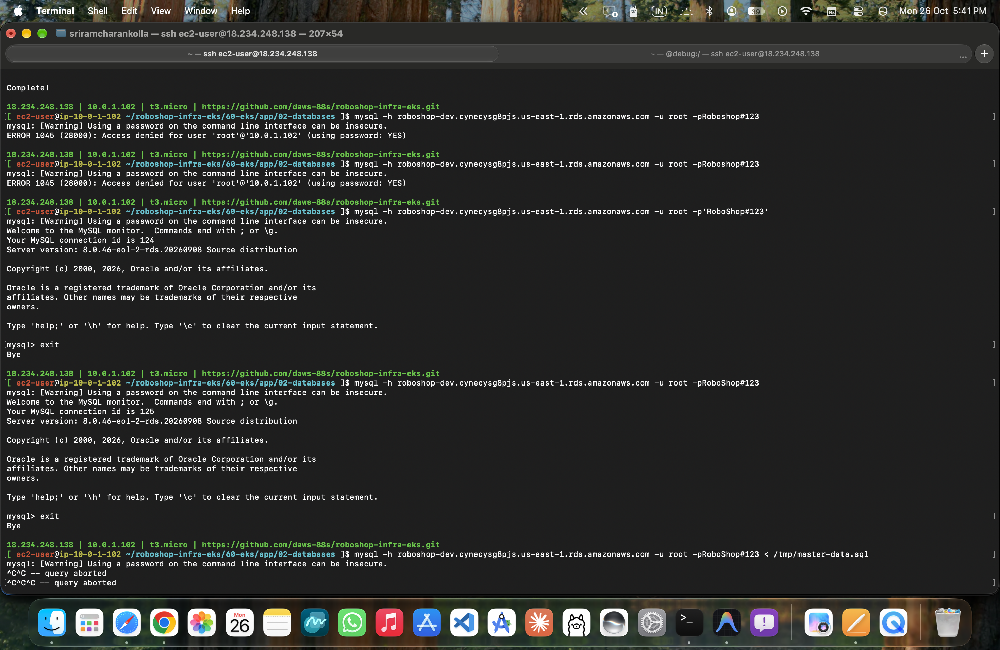
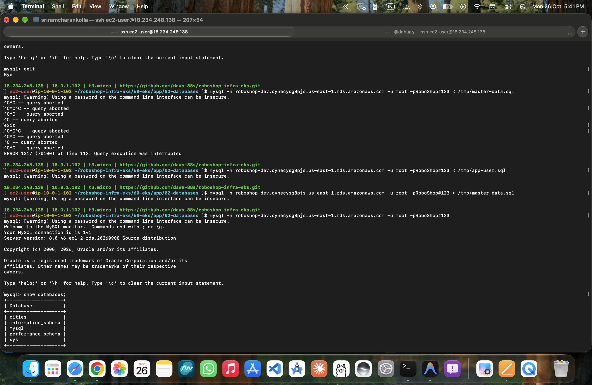

---

### 4. Stateless Microservices Deployment (Helm)

All application services (Catalogue, Cart, User, Shipping, Payment) are packaged as Helm charts located under `60-eks/app/03-backend/`.

#### Inspect Microservices Charts:
```bash
cd /home/ec2-user/roboshop-infra-eks/60-eks/app/03-backend
ls -l
```

#### Proof of Work:
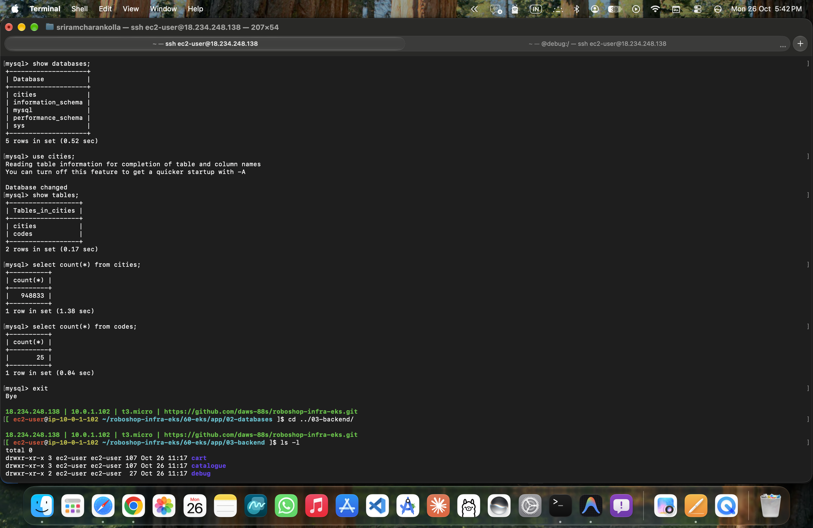

#### Deploy Services via Helm:
```bash
helm upgrade --install catalogue ./catalogue
helm upgrade --install user ./user
helm upgrade --install cart ./cart
helm upgrade --install shipping ./shipping
helm upgrade --install payment ./payment
```

#### Deploy Debug Container & Verify Health:
Deploy a diagnostic container to confirm internal DNS service discovery and MongoDB database connectivity:

```bash
# Deploy debug pod
kubectl apply -f /home/ec2-user/roboshop-infra-eks/60-eks/app/03-backend/debug/manifest.yaml

# Test catalogue microservice health
kubectl exec -it debug -n roboshop -- curl -s http://catalogue:8080/health
# Expected Output: {"app":"OK","mongo":true}
```

#### Proof of Work:
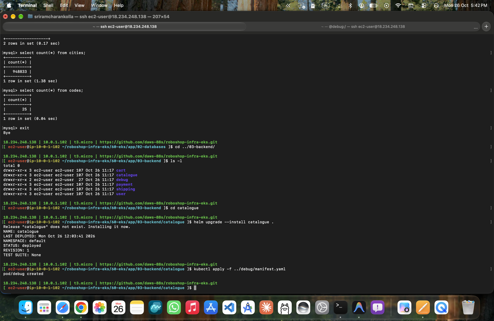
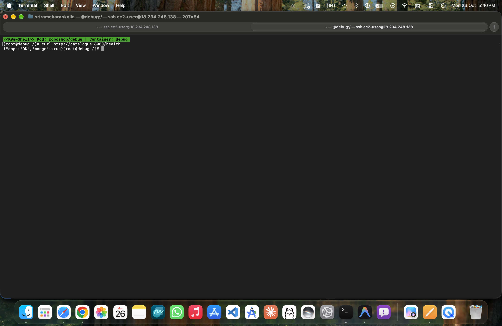

#### Real-time Cluster Observability with K9s:
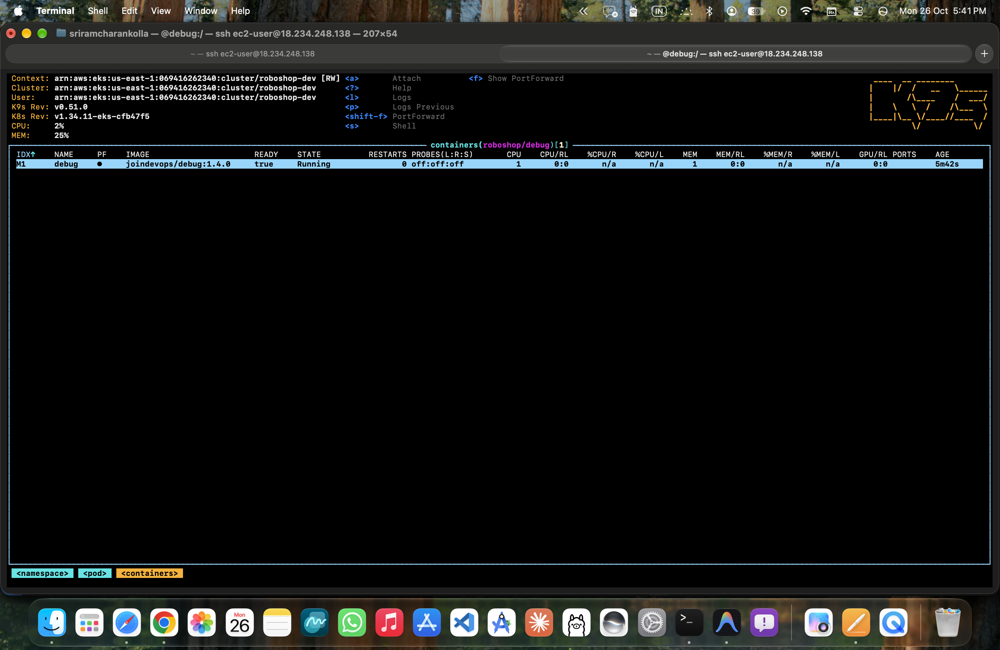

---

### 5. Exposing Applications to the Internet

RoboShop supports 3 production traffic ingress patterns:

1. **Ingress Controller (Classic)**: AWS Load Balancer Controller provisions ALB dynamically via `Ingress` resource.
2. **Gateway API (Modern)**: Next-gen decoupled platform routing using `GatewayClass`, `Gateway`, and `HTTPRoute` (Requires CRD v1.5.0+ and AWS Gateway CRDs).
3. **Target Group Binding (TGB - Recommended for Enterprise)**: Connects a Terraform pre-provisioned ALB (`80-frontend-alb`) to the EKS `frontend` service using the `TargetGroupBinding` CRD (`elbv2.k8s.aws/v1beta1`).

#### Target Group Binding Deployment:
```bash
# 1. Deploy Frontend service
kubectl apply -f /home/ec2-user/k8-roboshop/frontend/manifest.yaml

# 2. Apply TargetGroupBinding linking K8s Service to AWS Target Group ARN
kubectl apply -f /home/ec2-user/roboshop-infra-eks/60-eks/app/tgb.yaml

# 3. Verify targets in AWS ALB Target Group
aws elbv2 describe-target-health \
  --target-group-arn <TARGET_GROUP_ARN> \
  --region us-east-1
# Target status: healthy
```

#### End-to-End Application Verification:

| Page / Feature | Tested Flow | Proof of Work |
| :--- | :--- | :--- |
| **Storefront** | Product listings & dynamic catalogue loaded from MongoDB | 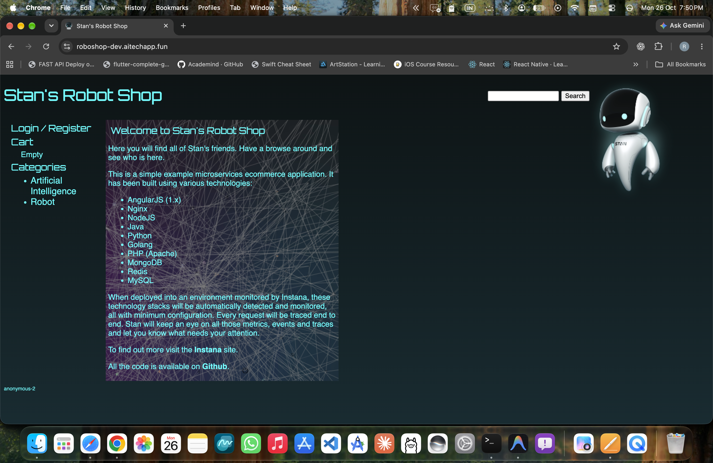 |
| **User Auth** | User registration and authentication via Redis & Mongo | 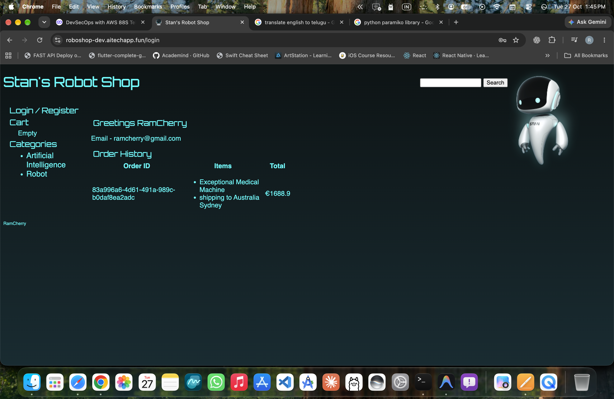 |
| **Cart & Shipping** | Distance computation & shipping cost calculation from RDS | 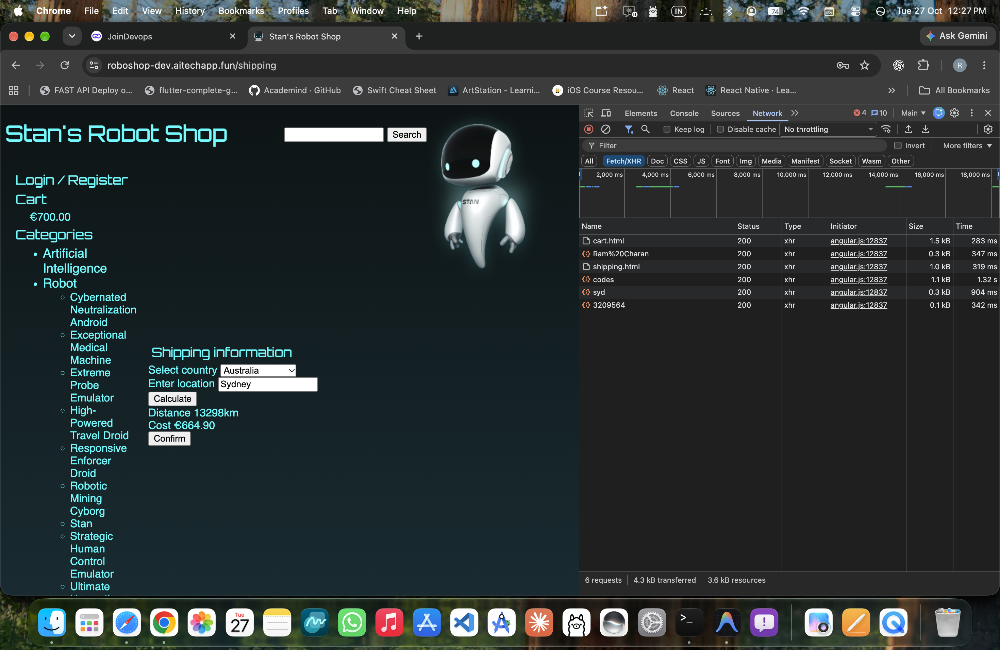 |
| **Payment** | Order transaction dispatch to RabbitMQ queue | 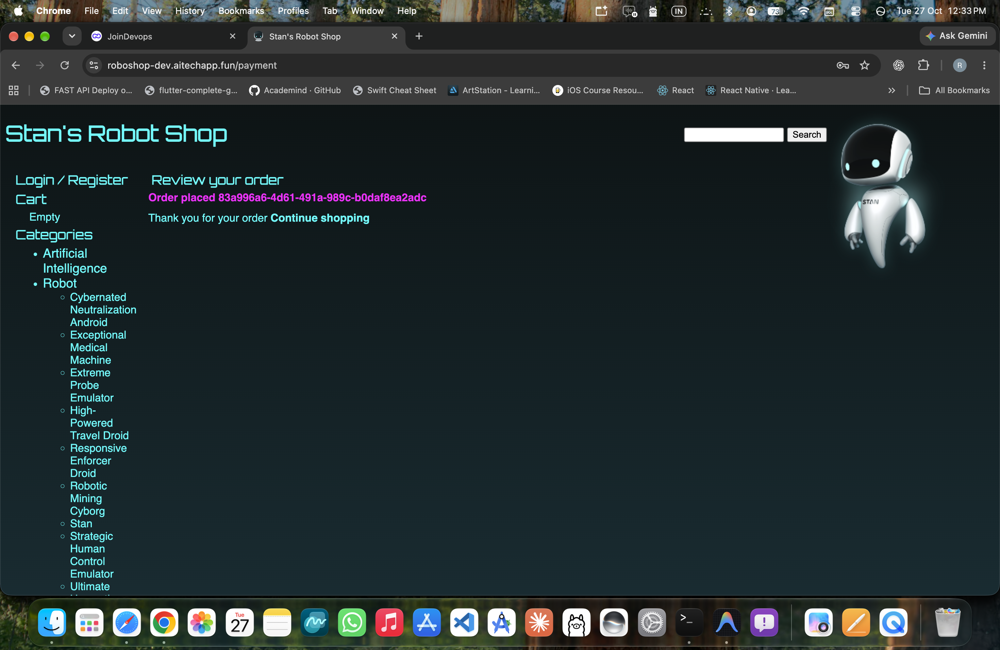 |

---

### 6. Zero-Downtime EKS Blue/Green Cluster Upgrade (1.34 -> 1.35)

Our infrastructure module `60-eks` integrates with `terraform-aws-eks` using a dynamic nodegroup local map (`for_each = local.active_node_groups`) to perform zero-downtime upgrades:

```
[Phase 1] Control Plane Upgrade: 1.34 -> 1.35
                      │
                      ▼
[Phase 2] Addon Upgrades: vpc-cni, coredns, kube-proxy, metrics-server
                      │
                      ▼
[Phase 3] Provision Green Nodegroup: 1.35 nodes join cluster
                      │
                      ▼
[Phase 4] Cordon & Drain Blue Nodes: Pods gracefully migrate
                      │
                      ▼
[Phase 5] Decommission Blue Nodegroup via Terraform
```

#### Step 1: Upgrade EKS Control Plane (Local Mac)
```bash
cd 60-eks
terraform apply \
  -var="eks_version=1.35" \
  -var="eks_nodegroup_blue_version=1.34" \
  -auto-approve
```
#### Proof of Work:
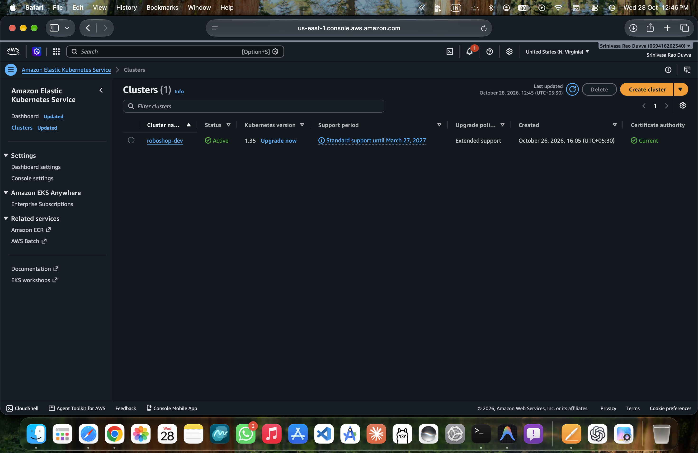

#### Step 2: Upgrade Managed Addons (Bastion)
```bash
for addon in vpc-cni eks-pod-identity-agent coredns kube-proxy metrics-server; do
  LATEST=$(aws eks describe-addon-versions \
    --kubernetes-version 1.35 \
    --addon-name $addon \
    --query 'addons[0].addonVersions[0].addonVersion' \
    --output text)
  aws eks update-addon \
    --cluster-name roboshop-dev \
    --addon-name $addon \
    --addon-version $LATEST \
    --resolve-conflicts OVERWRITE \
    --region us-east-1
done
```
#### Proof of Work:
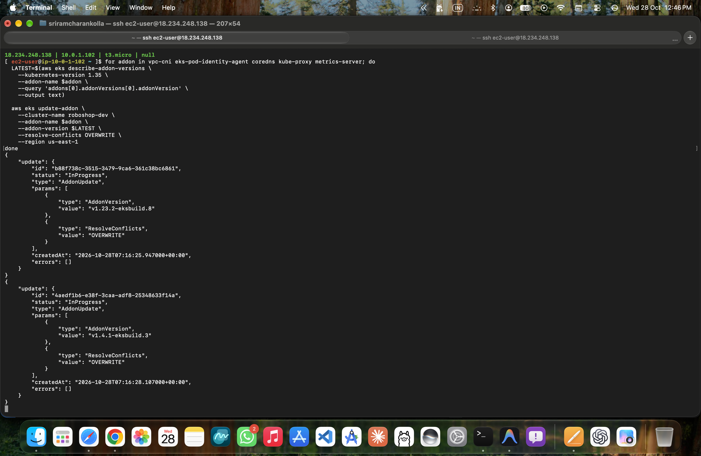

#### Step 3: Provision Green Nodegroup (Local Mac)
```bash
terraform apply \
  -var="eks_version=1.35" \
  -var="eks_nodegroup_blue_version=1.34" \
  -var="enable_green=true" \
  -auto-approve
```

#### Step 4: Cordon & Drain Blue Nodes Gracefully (Bastion)
```bash
# Stop new pods from scheduling on Blue
kubectl cordon -l nodegroup=blue

# Drain nodes one-by-one so PodDisruptionBudgets allow graceful migration
kubectl drain <blue-node-1> --ignore-daemonsets --delete-emptydir-data
kubectl drain <blue-node-2> --ignore-daemonsets --delete-emptydir-data
```

#### Step 5: Decommission Blue Nodegroup (Local Mac)
```bash
terraform apply \
  -var="eks_version=1.35" \
  -var="enable_blue=false" \
  -var="enable_green=true" \
  -auto-approve
```

---

## Infrastructure Teardown & Destroy Playbook

> [!CAUTION]
> **CRITICAL GOTCHA: The "Dangling Cloud Resources" Dependency Trap**
>
> If you execute `terraform destroy` starting directly from `80-frontend-alb` backwards down to `00-vpc` without cleaning up Kubernetes workloads first, **Terraform WILL FAIL or HANG indefinitely** when destroying `60-eks`, `10-sg`, and `00-vpc`!
>
> ### Why does this happen?
> 1. **Dynamic EBS Volumes**: The AWS EBS CSI Driver dynamically provisioned AWS EBS volumes for MongoDB and RabbitMQ PVCs. These volumes are bound to worker node EC2 instances. If worker nodes or nodegroups are destroyed before deleting PVCs, EBS volumes remain attached or orphaned in AWS, blocking volume detach and subnet cleanup.
> 2. **Target Group Bindings (TGB)**: If `80-frontend-alb` is destroyed while pods are actively registered in the target group, AWS will hold connections in draining state or reject target group deletion.
> 3. **AWS Load Balancer Controller ENIs & Security Groups**: The ALB controller creates dynamic security group ingress rules and network interfaces. Terraform has no knowledge of these in its state file, causing `10-sg` and `00-vpc` deletion to fail with `DependencyViolation`.
> 4. **VPC-CNI Secondary ENIs**: Kubernetes pods have secondary private IPs assigned from VPC subnets. AWS strictly prohibits deleting any subnet that has active Network Interfaces (ENIs).

### Mandatory 2-Phase Teardown Execution:

```
[Phase 0: Kubernetes Teardown on Bastion] 
  1. Delete TGB & Ingress ──> 2. Uninstall Apps ──> 3. Delete PVCs & Storage ──> 4. Delete Controllers & NS
                                                                                     │
                                                                                     ▼
[Phase 1: Reverse Terraform Destroy on Local Mac]
  80-frontend-alb ──> 70-acm ──> 61-eks-iam ──> 60-eks ──> 50-ecr ──> 40-rds ──> 31-tools ──> 30-bastion ──> 20-rules ──> 10-sg ──> 00-vpc
```

### Phase 0: Kubernetes Clean-Up (Execute on Bastion FIRST)

Log in to Bastion and run the following in order:

```bash
# 1. Delete Target Group Binding and Ingress
kubectl delete -f /home/ec2-user/roboshop-infra-eks/60-eks/app/tgb.yaml --ignore-not-found
kubectl delete ingress --all -n roboshop

# 2. Uninstall all stateless microservices
helm uninstall frontend catalogue cart user shipping payment -n roboshop --ignore-not-found

# 3. Delete stateful database workloads
kubectl delete -f /home/ec2-user/roboshop-infra-eks/60-eks/app/02-databases/mongodb/manifest.yaml --ignore-not-found
kubectl delete -f /home/ec2-user/roboshop-infra-eks/60-eks/app/02-databases/redis/manifest.yaml --ignore-not-found
kubectl delete -f /home/ec2-user/roboshop-infra-eks/60-eks/app/02-databases/rabbitmq/manifest.yaml --ignore-not-found

# 4. CRITICAL: Delete all PersistentVolumeClaims to release AWS EBS volumes!
kubectl delete pvc --all -n roboshop

# Verify all PVCs and PVs are fully terminated
kubectl get pvc -n roboshop
kubectl get pv

# 5. Delete debug pod and roboshop namespace
kubectl delete pod debug -n roboshop --ignore-not-found
kubectl delete ns roboshop

# 6. Uninstall Kubernetes controllers and StorageClass
helm uninstall aws-load-balancer-controller -n kube-system --ignore-not-found
helm uninstall aws-ebs-csi-driver -n kube-system --ignore-not-found
kubectl delete -f /home/ec2-user/roboshop-infra-eks/60-eks/app/01-storage-class/ebs-sc.yaml --ignore-not-found
```

---

### Phase 1: Reverse Terraform Destroy (Execute on Local Mac)

Once Phase 0 is complete and all cloud resources created by Kubernetes controllers are released, destroy the Terraform modules in exact reverse order:

```bash
# 1. Destroy Frontend Application Load Balancer
cd /Users/sriramcharankolla/Desktop/DevOps/roboshop-infra-eks/80-frontend-alb
terraform destroy -auto-approve

# 2. Destroy ACM Certificate & DNS Validation Records
cd ../70-acm
terraform destroy -auto-approve

# 3. Destroy EKS IAM Roles (IRSA)
cd ../61-eks-iam
terraform destroy -auto-approve

# 4. Destroy EKS Cluster & Node Groups
cd ../60-eks
terraform destroy -auto-approve

# 5. Destroy ECR Repositories
cd ../50-ecr
terraform destroy -auto-approve

# 6. Destroy Amazon RDS MySQL Database (Ensure skip_final_snapshot = true in dev)
cd ../40-rds
terraform destroy -auto-approve

# 7. Destroy CI/CD Tools Workstation (if provisioned)
cd ../31-cicd-tools
terraform destroy -auto-approve

# 8. Destroy Bastion Host
cd ../30-bastion
terraform destroy -auto-approve

# 9. Destroy Cross-Referenced Security Group Rules
cd ../20-sg-rules
terraform destroy -auto-approve

# 10. Destroy Core Security Groups
cd ../10-sg
terraform destroy -auto-approve

# 11. Destroy Custom VPC, Subnets, NAT Gateways, Route Tables
cd ../00-vpc
terraform destroy -auto-approve
```

---

## Reference Documentation
- [Comprehensive Learning & Troubleshooting Guide](learning.md): 1,500+ lines covering every architecture decision, failure RCA, and interview deep dives.
- [High Availability & PodDisruptionBudget Deep Dive](../k8-ha/README.md): PDB math, TopologySpreadConstraints, and live interactive simulators.