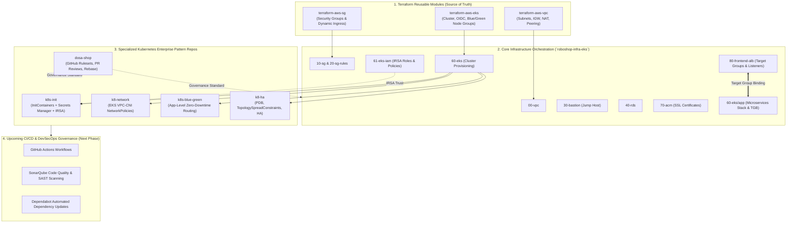
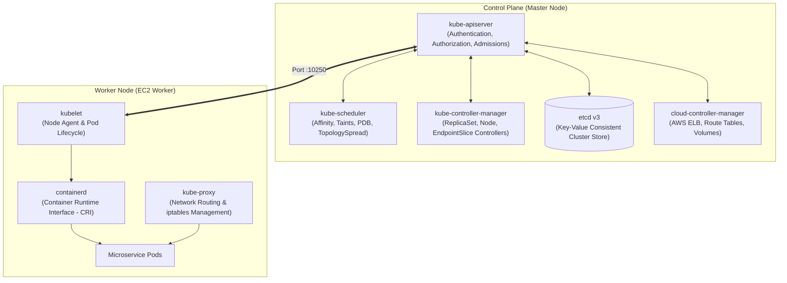
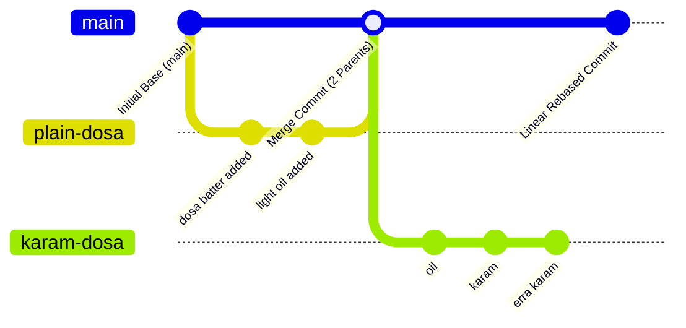

# Terraform State Locking & Troubleshooting (`learning.md`)

## 1. Problem Scenario: State Lock Error After Interrupted Apply

When running `terraform apply` or `terraform plan`, Terraform acquires a state lock to protect the remote state file from concurrent modifications. 

If the process is interrupted abruptly (e.g., hitting `Ctrl+C`, network failure, laptop going to sleep, or terminal crash):
* Terraform may not get the chance to release the lock.
* Subsequent runs fail with:
```text
Error: Error acquiring the state lock
Error message: operation error S3: PutObject ... StatusCode: 412, PreconditionFailed
Lock Info:
  ID:        <LOCK_ID> (e.g. 1f6c9afe-bd7a-eb0f-3e6a-fb29461a0791)
  Path:      devsecops-terraform-remote-state/terraform-eks-bastion
  Operation: OperationTypeApply
  Who:       sriramcharankolla@...
```

---

## 2. Why `terraform init -reconfigure` Does NOT Work

* `terraform init -reconfigure` only reconfigures your **local `.terraform` cache and directory settings**.
* The **lock is held remotely** inside the S3 bucket / DynamoDB table.
* Reconfiguring local settings will not delete or release the remote lock.

---

## 3. How to Fix (Two Methods)

### Method 1: Using `terraform force-unlock` (Recommended)

1. Grab the **Lock ID** from the error message output:
   ```text
   Lock Info:
     ID: 1f6c9afe-bd7a-eb0f-3e6a-fb29461a0791
   ```

2. Run `terraform force-unlock` in the same directory:
   ```bash
   terraform force-unlock <LOCK_ID>
   ```
   *Example:*
   ```bash
   terraform force-unlock 1f6c9afe-bd7a-eb0f-3e6a-fb29461a0791
   ```

3. Type `yes` when prompted:
   ```text
   Do you really want to force-unlock?
     Enter a value: yes
   ```

---

### Method 2: For S3 Native Lockfiles (`use_lockfile = true`)

In Terraform >= 1.10, the AWS S3 backend supports native locking via `use_lockfile = true` instead of DynamoDB.

If network issues prevent `force-unlock` from connecting, delete the `.tflock` object directly using the AWS CLI:

```bash
aws s3 rm s3://<BUCKET_NAME>/<STATE_KEY>.tflock --region <REGION>
```

*Example for 30-bastion:*
```bash
aws s3 rm s3://devsecops-terraform-remote-state/terraform-eks-bastion.tflock --region us-east-1
```

---

## 5. Scenario 2: State Lock + `errored.tfstate` (Failed to Persist State to Backend)

### When Does This Happen?
During long-running resources (e.g. AWS RDS database creation taking 5–10 minutes), if internet drops while Terraform is polling or persisting state:
1. The AWS resource is successfully created in AWS.
2. But Terraform fails to reach S3 to upload the new state.
3. Terraform dumps the state locally to `errored.tfstate` to prevent data loss.
4. The remote `.tflock` remains stuck in S3.

### Resolution Steps (Do NOT Skip Step 2!):

1. **Unlock the State**:
   ```bash
   terraform force-unlock <LOCK_ID>
   # Or via AWS CLI:
   aws s3 rm s3://<BUCKET_NAME>/<STATE_KEY>.tflock --region <REGION>
   ```

2. **Push Local State to S3 Remote Backend (Crucial)**:
   ```bash
   terraform state push errored.tfstate
   ```
   > ⚠️ **Warning**: Never run `terraform apply` before pushing `errored.tfstate`. If you apply without pushing, Terraform won't know the resources already exist and will cause collision/forked state errors!

3. **Delete Local Errored State File**:
   ```bash
   rm errored.tfstate
   ```

4. **Re-run Apply to Verify**:
   ```bash
   terraform apply -auto-approve
   ```
   Terraform will inspect AWS, match the existing resource, and exit cleanly with 0 errors.

---

## 6. Manual Configuration & Helm Deployment via Bastion (When Using Upstream `daws-88s` Repo)

### Why Manual Changes Are Needed on Bastion
When Bastion clones the public upstream repository (`https://github.com/daws-88s/roboshop-infra-eks`):
1. You do not have write/push access to upstream GitHub.
2. Changes made locally on your Mac cannot be pulled directly on Bastion via `git pull`.
3. Dynamic infrastructure values (such as your newly provisioned AWS RDS endpoint `roboshop-dev.cynecysg8pjs.us-east-1.rds.amazonaws.com`) must be configured directly on the Bastion server.

---

### Step 1: Fix the Shipping Microservice RDS Endpoint on Bastion

#### Option A: One-Line `sed` Command (Fastest & Recommended)
Run these commands on the Bastion terminal:
```bash
cd ~/roboshop-infra-eks/60-eks/app/03-backend/shipping

# Replace any existing RDS hostname with your active RDS endpoint
sed -i 's/roboshop-dev\..*\.rds\.amazonaws\.com/roboshop-dev.cynecysg8pjs.us-east-1.rds.amazonaws.com/g' values-dev.yaml values.yaml values-prod.yaml

# Verify the changes
cat values-dev.yaml
```

#### Option B: Deploy Using Helm `--set` Flag (No File Editing Needed)
You can directly pass the dynamic RDS hostname at deployment time without modifying the files:
```bash
cd ~/roboshop-infra-eks/60-eks/app/03-backend/shipping
helm upgrade --install shipping -f values-dev.yaml . --set configMap.DB_HOST="roboshop-dev.cynecysg8pjs.us-east-1.rds.amazonaws.com"
```

#### Option C: Manual Editing with `vim` / `vi`
1. Open the file on Bastion:
   ```bash
   vim values-dev.yaml
   ```
2. Navigate with arrow keys to line 3 (`DB_HOST:`).
3. Press `cw` or `i` to enter Insert mode.
4. Replace the old host with `roboshop-dev.cynecysg8pjs.us-east-1.rds.amazonaws.com`.
5. Press `Esc` then type `:wq` and press `Enter` to save and exit.

---

### Step 2: Fix Cart Values on Bastion (Ensure it does not point to Frontend)
Check `cart/values.yaml` on Bastion:
```bash
cd ~/roboshop-infra-eks/60-eks/app/03-backend/cart

cat << 'EOF' > values.yaml
configMap:
  REDIS_HOST: "redis"
  CATALOGUE_HOST: "catalogue"
  CATALOGUE_PORT: "8080"
deployment:
  replicas: "1"
  imageName: "joindevops/cart"
  imageVersion: "1.4.0"
EOF

# Deploy / upgrade cart
helm upgrade --install cart -f values-dev.yaml .
```

---

### Step 3: Complete Microservices Deployment Order on Bastion

Always deploy in this exact sequence:

1. **Storage Class & Namespace**:
   ```bash
   cd ~/roboshop-infra-eks/60-eks/app
   kubectl apply -f namespace.yaml
   cd 01-storage-class && kubectl apply -f .
   ```

2. **Databases (StatefulSets)**:
   ```bash
   cd ~/roboshop-infra-eks/60-eks/app/02-databases
   kubectl apply -f mongodb/manifest.yaml
   kubectl apply -f redis/manifest.yaml
   kubectl apply -f rabbitmq/manifest.yaml
   ```

3. **Backend Services (Helm Charts)**:
   ```bash
   # Catalogue
   cd ~/roboshop-infra-eks/60-eks/app/03-backend/catalogue
   helm upgrade --install catalogue -f values.yaml .

   # User
   cd ~/roboshop-infra-eks/60-eks/app/03-backend/user
   helm upgrade --install user -f values.yaml .

   # Cart
   cd ~/roboshop-infra-eks/60-eks/app/03-backend/cart
   helm upgrade --install cart -f values-dev.yaml .

   # Shipping (With RDS Endpoint)
   cd ~/roboshop-infra-eks/60-eks/app/03-backend/shipping
   helm upgrade --install shipping -f values-dev.yaml . --set configMap.DB_HOST="roboshop-dev.cynecysg8pjs.us-east-1.rds.amazonaws.com"

   # Payment
   cd ~/roboshop-infra-eks/60-eks/app/03-backend/payment
   helm upgrade --install payment -f values-dev.yaml .
   ```

4. **Frontend**:
   ```bash
   cd ~/roboshop-infra-eks/60-eks/app/04-frontend
   helm upgrade --install frontend -f values.yaml .
   ```

---

### Step 4: Verification & Troubleshooting in `k9s`
- Launch `k9s`:
  ```bash
  k9s -n roboshop
  ```
- If any pod crashed before the config was updated, restart it:
  ```bash
  kubectl rollout restart deployment shipping -n roboshop
  ```
- In `k9s`:
  - Press <kbd>l</kbd> on any pod to tail logs.
  - Press <kbd>Esc</kbd> to return to the pod list.
  - Press <kbd>d</kbd> to describe the pod and inspect events.

---

## 7. In-Cluster Databases (Redis, RabbitMQ, MongoDB) & Interpreting `k9s` Metrics

### Architecture & Service Roles
In `roboshop-infra-eks`, the non-relational database tier runs **inside Kubernetes as StatefulSets with AWS EBS CSI persistent volumes** (`storageClassName: "roboshop-ebs"`):
- **Redis**: [02-databases/redis/manifest.yaml](file:///Users/sriramcharankolla/Desktop/DevOps/roboshop-infra-eks/60-eks/app/02-databases/redis/manifest.yaml#L1-L83)
  - `cart` service connects via [cart/values-dev.yaml:L2](file:///Users/sriramcharankolla/Desktop/DevOps/roboshop-infra-eks/60-eks/app/03-backend/cart/values-dev.yaml#L2) (`REDIS_HOST: "redis"`) to store cart items.
  - `user` service connects via [user/values.yaml:L2](file:///Users/sriramcharankolla/Desktop/DevOps/roboshop-infra-eks/60-eks/app/03-backend/user/values.yaml#L2) (`REDIS_URL: "redis://redis:6379"`) for session token caching.
- **RabbitMQ**: [02-databases/rabbitmq/manifest.yaml](file:///Users/sriramcharankolla/Desktop/DevOps/roboshop-infra-eks/60-eks/app/02-databases/rabbitmq/manifest.yaml#L1-L95)
  - `payment` service connects via [payment/values-dev.yaml:L6-L8](file:///Users/sriramcharankolla/Desktop/DevOps/roboshop-infra-eks/60-eks/app/03-backend/payment/values-dev.yaml#L6-L8) (`AMQP_HOST: rabbitmq`) to queue payment events.
- **MongoDB**: [02-databases/mongodb/manifest.yaml](file:///Users/sriramcharankolla/Desktop/DevOps/roboshop-infra-eks/60-eks/app/02-databases/mongodb/manifest.yaml#L1-L83)
  - `catalogue` and `user` query product catalogs and user accounts.

### Understanding `n/a` in `k9s` Metrics Columns
In `k9s`, you may see `n/a` under `%CPU/R`, `%CPU/L`, `%MEM/R`, and `%MEM/L` for `redis-0`, `rabbitmq-0`, `mongodb-0`, or `debug`.
- **Cause**: The percentage columns calculate:
  $$\% \text{CPU/R} = \frac{\text{Actual Usage}}{\text{CPU Request}} \times 100$$
  Since the database `manifest.yaml` files do not define `resources.requests` or `resources.limits`, there is no request/limit denominator to calculate a percentage.
- **Verification**: Look at the un-percentaged `CPU` and `MEM` columns. They show real-time usage (e.g. `1m` CPU, `3Mi` RAM). The pod is actively running and utilizing resources normally.

---

## 8. AWS Load Balancer Controller Installation via `eksctl`

### Error 1: `EntityAlreadyExists: A policy called AWSLoadBalancerControllerIAMPolicy already exists`
- **Cause**: IAM policies are global to the AWS account. If you created this policy during a previous run, AWS rejects duplicate creation.
- **Fix**: Skip `aws iam create-policy` and directly use the existing policy ARN:
  ```text
  arn:aws:iam::<ACCOUNT_ID>:policy/AWSLoadBalancerControllerIAMPolicy
  ```

### Error 2: `ResourceNotFoundException: No cluster found for name: roboshop`
- **Cause**: In [60-eks/main.tf:L4](file:///Users/sriramcharankolla/Desktop/DevOps/roboshop-infra-eks/60-eks/main.tf#L4), the cluster is named `${var.project}-${var.environment}` = **`roboshop-dev`**, not `roboshop`.
- **Fix**: Pass `--cluster=roboshop-dev` to `eksctl`:
  ```bash
  eksctl create iamserviceaccount \
    --cluster=roboshop-dev \
    --namespace=kube-system \
    --name=aws-load-balancer-controller \
    --attach-policy-arn=arn:aws:iam::069416262340:policy/AWSLoadBalancerControllerIAMPolicy \
    --override-existing-serviceaccounts \
    --region us-east-1 \
    --approve
  ```

### Step 3: Helm Install AWS Load Balancer Controller
```bash
helm repo add eks https://aws.github.io/eks-charts
helm repo update eks

helm install aws-load-balancer-controller eks/aws-load-balancer-controller \
  -n kube-system \
  --set clusterName=roboshop-dev \
  --set serviceAccount.create=false \
  --set serviceAccount.name=aws-load-balancer-controller
```

---

## 9. Frontend Ingress HTTPS / 443 `ERR_CONNECTION_REFUSED`

### Symptoms
- Route 53 record for `*.aitechapp.fun` pointed to the Application Load Balancer.
- Navigating to `https://roboshop-dev.aitechapp.fun` resulted in browser error:
  `ERR_CONNECTION_REFUSED`.

### Root Cause Flow
1. **Hardcoded Stale Certificate**:
   - In upstream [04-frontend/templates/ingress.yaml:L12](file:///Users/sriramcharankolla/Desktop/DevOps/roboshop-infra-eks/60-eks/app/04-frontend/templates/ingress.yaml#L12), the ACM certificate was hardcoded to instructor account `160885265516`:
     ```yaml
     alb.ingress.kubernetes.io/certificate-arn: 'arn:aws:acm:us-east-1:160885265516:certificate/b6983d9a-848d-4898-8335-81c74db10bc3'
     ```
2. **Controller Reconcile Error**:
   - In AWS Load Balancer Controller logs:
     ```text
     CreateListener, StatusCode: 400, CertificateNotFound: Certificate 'arn:aws:acm:us-east-1:160885265516:certificate/...' not found
     ```
3. **Empty ALB Listeners**:
   - Because the listener failed to create, running `aws elbv2 describe-listeners` showed `"Listeners": []`.
   - The ALB had no listener on Port 443, dropping incoming TCP connections and triggering `ERR_CONNECTION_REFUSED`.

### Resolution Steps
1. Retrieve your active AWS Certificate Manager ARN for `*.aitechapp.fun`:
   ```bash
   aws acm list-certificates --region us-east-1
   # ARN: arn:aws:acm:us-east-1:069416262340:certificate/e09fdd96-80c6-4814-a235-89c17501f08f
   ```
2. Update [04-frontend/templates/ingress.yaml:L12](file:///Users/sriramcharankolla/Desktop/DevOps/roboshop-infra-eks/60-eks/app/04-frontend/templates/ingress.yaml#L12) to reference your certificate:
   ```yaml
   alb.ingress.kubernetes.io/certificate-arn: 'arn:aws:acm:us-east-1:069416262340:certificate/e09fdd96-80c6-4814-a235-89c17501f08f'
   ```
3. Update [04-frontend/values.yaml:L5-L6](file:///Users/sriramcharankolla/Desktop/DevOps/roboshop-infra-eks/60-eks/app/04-frontend/values.yaml#L5-L6):
   ```yaml
   ingress:
     host: "roboshop-dev.aitechapp.fun"
   ```
4. Run `helm upgrade --install frontend -f values.yaml .`.
   - The AWS Load Balancer Controller automatically creates the HTTPS Port 443 listener with the SSL certificate and forwards `roboshop-dev.aitechapp.fun` to the frontend target group.

---

## 10. Private EKS Control Plane Architecture & Tooling

### Why Helm & Kubectl Run Exclusively from Bastion
- In [terraform-aws-eks/main.tf:L24-L25](file:///Users/sriramcharankolla/Desktop/DevOps/terraform-aws-eks/main.tf#L24-L25):
  ```hcl
  endpoint_private_access = true
  endpoint_public_access  = false
  ```
- Because the Kubernetes API server has public internet access disabled, laptops and MacBooks cannot reach the cluster control plane directly without an established Site-to-Site or Client VPN tunnel.
- The Bastion host is inside the VPC public subnet and has private network routing to the EKS control plane ENIs. All `helm`, `kubectl`, `eksctl`, and `k9s` commands should be executed from the Bastion host.

---

## 11. Bastion SSH "Operation Timed Out" (Dynamic ISP Public IP)

### Problem Description
When running `ssh ec2-user@18.234.248.138`, the client hangs and fails with:
```text
ssh: connect to host 18.234.248.138 port 22: Operation timed out
```

### Root Cause
1. In [20-sg-rules/main.tf:L2-L11](file:///Users/sriramcharankolla/Desktop/DevOps/roboshop-infra-eks/20-sg-rules/main.tf#L2-L11), the Bastion SSH ingress rule restricts Port 22 access strictly to `local.my_ip` rather than `0.0.0.0/0`:
   ```hcl
   resource "aws_security_group_rule" "bastion_internet" {
     type        = "ingress"
     from_port   = 22
     to_port     = 22
     protocol    = "tcp"
     cidr_blocks = [local.my_ip]
     security_group_id = local.bastion_sg_id
   }
   ```
2. In [20-sg-rules/locals.tf:L2](file:///Users/sriramcharankolla/Desktop/DevOps/roboshop-infra-eks/20-sg-rules/locals.tf#L2) and [20-sg-rules/data.tf:L1-L3](file:///Users/sriramcharankolla/Desktop/DevOps/roboshop-infra-eks/20-sg-rules/data.tf#L1-L3), `local.my_ip` fetches the developer's public IP using `https://ipv4.icanhazip.com`:
   ```hcl
   data "http" "my_public_ip_v4" {
     url = "https://ipv4.icanhazip.com"
   }

   locals {
     my_ip = "${chomp(data.http.my_public_ip_v4.response_body)}/32"
   }
   ```
3. Whenever your ISP, Wi-Fi router, or mobile hotspot reassigns or renews your public IP lease (e.g. overnight or after reconnecting), the existing AWS Security Group rule still holds the previous IP.
4. AWS Security Groups drop packets from unauthorized IPs silently without sending TCP RST, causing the SSH client to wait for a SYN-ACK until it times out.

### Resolution Steps
1. Verify your current public IP from your terminal:
   ```bash
   curl -s https://checkip.amazonaws.com
   ```
2. Re-apply the security group rules to refresh `local.my_ip`:
   ```bash
   cd ~/Desktop/DevOps/roboshop-infra-eks/20-sg-rules
   terraform apply -auto-approve
   ```
   Terraform fetches the newly assigned public IP and immediately updates the Bastion security group rule in AWS.
3. Verify Port 22 connectivity:
   ```bash
   nc -zv 18.234.248.138 22
   # Expected output: Connection to 18.234.248.138 port 22 [tcp/ssh] succeeded!
   ```
4. Connect to Bastion:
   ```bash
   ssh ec2-user@18.234.248.138
   ```

---

## 12. Cart Microservice 500 Internal Server Error (`NR_CLOSED` - Node-Redis Closed)

### Symptoms
- When adding an item to the shopping cart from the browser or via curl:
  ```bash
  curl -s https://roboshop-dev.aitechapp.fun/api/cart/add/user1/UHJ/1
  ```
- The response returns HTTP `500 Internal Server Error`.

### Root Cause Flow
1. **Startup Race Condition**:
   - The Node.js `cart` service was started before the `redis-0` StatefulSet pod was deployed or ready.
2. **Socket Timeout**:
   - The `cart` application attempted to connect to `redis:6379`. Because Redis was unreachable, the Node-Redis client library closed the TCP socket and entered a permanent `NR_CLOSED` error state.
3. **Application Log Evidence**:
   ```json
   {"level":"error","time":1729953841,"msg":"ERROR {\"command\":\"GET\",\"code\":\"NR_CLOSED\",\"args\":[\"user1\"]}"}
   ```
4. Even after `redis-0` becomes healthy (`1/1 Running`), the already-running Node.js process does not always re-establish a dead connection pool automatically.

### Resolution Steps
1. Verify `redis-0` is healthy:
   ```bash
   kubectl get pods -n roboshop -l app=redis
   # Expected: redis-0   1/1   Running
   ```
2. Restart the `cart` deployment to re-initialize the connection pool:
   ```bash
   kubectl rollout restart deployment cart -n roboshop
   ```
3. Verify `cart` logs show successful Redis connection:
   ```bash
   kubectl logs -n roboshop -l app=cart -c cart --tail=50 | grep -i "redis"
   # Expected: Redis READY
   ```
4. Test item addition again:
   ```bash
   curl -i https://roboshop-dev.aitechapp.fun/api/cart/add/user1/UHJ/1
   # Expected: HTTP/1.1 200 OK
   ```

---

## 13. Helm Release Management & Syntax Errors

### Error: `uninstall: Release name is invalid: repo/chart`
```text
$ helm uninstall aws-load-balancer-controller eks/aws-load-balancer-controller -n kube-system
release "aws-load-balancer-controller" uninstalled
Error: uninstall: Release name is invalid: eks/aws-load-balancer-controller
```

#### Why This Happens
- `helm install` syntax requires both the **release name** and the **chart name**:
  ```bash
  helm install <release-name> <chart-repo>/<chart-name> [flags]
  ```
- `helm uninstall` syntax **only** takes release names:
  ```bash
  helm uninstall <release-name> [flags]
  ```
- Helm interpreted `eks/aws-load-balancer-controller` as a second release name. Because release names follow Kubernetes DNS-1123 label standards, slashes (`/`) are illegal characters.
- **Key Takeaway**: The first argument `aws-load-balancer-controller` **was already uninstalled successfully**. The error on the second argument can be safely ignored.

### Accidental Deployment of Wrong Microservice into a Directory
- **Scenario**: Running `helm install user .` while inside `60-eks/app/03-backend/cart`.
- **Symptoms**: `helm list -n roboshop` shows a release with the wrong chart name or overlapping service selectors.
- **Fix**:
  1. Identify the release name:
     ```bash
     helm list -n roboshop
     ```
  2. Uninstall the misplaced release:
     ```bash
     helm uninstall user -n roboshop
     ```
  3. Navigate to the correct directory and deploy with appropriate values:
     ```bash
     cd ~/roboshop-infra-eks/60-eks/app/03-backend/cart
     helm upgrade --install cart -f values-dev.yaml .
     ```

---

## 14. Kubernetes Gateway API Deployment & Common Pitfalls

### Overview & Architecture
The Gateway API (`gateway.networking.k8s.io`) is the modern successor to Kubernetes Ingress. It uses:
- `GatewayClass`: Declares the controller handling the gateway (`gateway.k8s.aws/alb`).
- `LoadBalancerConfiguration`: Custom AWS CRD specifying ALB scheme (`internet-facing`) and IP type (`ipv4`).
- `Gateway`: Defines listening ports (Port 80 HTTP, Port 443 HTTPS) and TLS certificate options.
- `HTTPRoute`: Routes traffic based on hostname (`roboshop-dev.aitechapp.fun`) and path prefixes to backend Kubernetes services.

### Common Pitfalls & Fixes

#### Pitfall 1: `kubectl delete` with `--server-side`
```text
$ kubectl delete --server-side=true -f https://github.com/kubernetes-sigs/gateway-api/releases/download/v1.5.0/standard-install.yaml
error: unknown flag: --server-side
```
- **Cause**: `--server-side` is exclusively a flag for `kubectl apply` (Server-Side Apply) to track field-level schema ownership. `kubectl delete` does not use field management.
- **Fix**: Simply remove the flag:
  ```bash
  kubectl delete -f https://github.com/kubernetes-sigs/gateway-api/releases/download/v1.5.0/standard-install.yaml
  ```

#### Pitfall 2: Stale ACM Certificate ARN in `gateway.yaml`
- In [60-eks/app/05-gateway/gateway.yaml:L26](file:///Users/sriramcharankolla/Desktop/DevOps/roboshop-infra-eks/60-eks/app/05-gateway/gateway.yaml#L26), the default upstream file references the instructor account `160885265516`.
- **Fix**: Update to your active ACM Certificate ARN (`069416262340`):
  ```yaml
  tls:
    mode: Terminate
    options:
      gateway.k8s.aws/certificate-arn: "arn:aws:acm:us-east-1:069416262340:certificate/e09fdd96-80c6-4814-a235-89c17501f08f"
  ```

#### Pitfall 3: Stale Hostname in `frontend.yaml`
- In [60-eks/app/05-gateway/frontend.yaml:L23](file:///Users/sriramcharankolla/Desktop/DevOps/roboshop-infra-eks/60-eks/app/05-gateway/frontend.yaml#L23), replace `daws88s.online` with your domain:
  ```yaml
  spec:
    hostnames:
    - "roboshop-dev.aitechapp.fun"
  ```

### Step-by-Step Gateway API Deployment Workflow (on Bastion)
1. **Apply standard Gateway API CRDs**:
   ```bash
   kubectl apply --server-side=true \
     -f https://github.com/kubernetes-sigs/gateway-api/releases/download/v1.5.0/standard-install.yaml
   ```
2. **Deploy Gateway resources in order**:
   ```bash
   cd ~/roboshop-infra-eks/60-eks/app/05-gateway
   kubectl apply -f gatewayclass.yaml
   kubectl apply -f loadbalancerconfiguration.yaml
   kubectl apply -f gateway.yaml
   kubectl apply -f frontend.yaml
   ```
3. **Verify Gateway status & ALB assignment**:
   ```bash
   kubectl get gateway -n roboshop
   # Ensure PROGRAMMED is True and ADDRESS contains the assigned AWS ALB DNS name
   ```

---

## 15. Verifying `aws eks update-kubeconfig` & Private Cluster API Access

### Purpose of the Command
```bash
aws eks update-kubeconfig --region us-east-1 --name roboshop-dev
```
- Calls the AWS EKS control plane API to retrieve cluster connection metadata (API server endpoint and base64-encoded Certificate Authority data).
- Generates or updates an entry in `~/.kube/config` with:
  - Cluster entry: Endpoint and CA certificate.
  - Context entry: Links the cluster to the active AWS IAM user/role authentication token.
  - Sets the newly updated context as `current-context`.

### How to Verify Configuration Success

#### 1. Check Active Context
```bash
kubectl config current-context
```
- **Expected Output**:
  ```text
  arn:aws:eks:us-east-1:069416262340:cluster/roboshop-dev
  ```

#### 2. Inspect Context Details
```bash
kubectl config get-contexts
```
- Displays all contexts configured in `~/.kube/config`. Look for an asterisk (`*`) next to `roboshop-dev`:
  ```text
  CURRENT   NAME                                                        CLUSTER                                                     AUTHINFO
  *         arn:aws:eks:us-east-1:069416262340:cluster/roboshop-dev      arn:aws:eks:us-east-1:069416262340:cluster/roboshop-dev      ...
  ```

#### 3. Test Live API Communication (The Definitive Test)
```bash
kubectl cluster-info
kubectl get nodes
```
- **Expected Output**:
  ```text
  Kubernetes control plane is running at https://<EKS_HASH>.sk1.us-east-1.eks.amazonaws.com
  CoreDNS is running at https://<EKS_HASH>.sk1.us-east-1.eks.amazonaws.com/api/v1/namespaces/kube-system/services/kube-dns:dns/proxy

  NAME                          STATUS   ROLES    AGE   VERSION
  ip-10-0-10-234.ec2.internal   Ready    <none>   1d    v1.34.0-eks-ba4534f
  ip-10-0-11-145.ec2.internal   Ready    <none>   1d    v1.34.0-eks-ba4534f
  ```

### Critical Architecture Note: Local MacBook vs Bastion Host

In [terraform-aws-eks/main.tf:L24-L25](file:///Users/sriramcharankolla/Desktop/DevOps/terraform-aws-eks/main.tf#L24-L25):
```hcl
endpoint_private_access = true
endpoint_public_access  = false
```

- **Running on Local Mac**:
  - `aws eks update-kubeconfig` queries AWS IAM/EKS APIs via public internet and successfully generates `~/.kube/config`.
  - However, running `kubectl get nodes` from your Mac will fail or time out with:
    `Unable to connect to the server: dial tcp: i/o timeout`.
  - **Reason**: The Kubernetes API server endpoint itself is completely private inside the AWS VPC and cannot be routed to over the public internet without an active VPN tunnel.
- **Running on Bastion Host (`18.234.248.138`)**:
  - Running both `aws eks update-kubeconfig` and `kubectl get nodes` on Bastion works immediately because Bastion resides within the VPC and has direct private IP routing to the EKS control plane ENIs.

---

## 16. AWS Load Balancer Controller Webhook Failure (`no endpoints available for service "aws-load-balancer-webhook-service"`)

### Symptoms
When creating a Kubernetes service of `type: LoadBalancer` (e.g., [02-main.service.yaml:L6](file:///Users/sriramcharankolla/Desktop/DevOps/k8s-blue-green/02-main.service.yaml#L6)):
```bash
$ kubectl apply -f 02-main.service.yaml
Error from server (InternalError): error when creating "02-main.service.yaml": Internal error occurred: failed calling webhook "mservice.elbv2.k8s.aws": failed to call webhook: Post "https://aws-load-balancer-webhook-service.kube-system.svc:443/mutate-v1-service?timeout=10s": no endpoints available for service "aws-load-balancer-webhook-service"
```

### Root Cause Flow
1. **Webhook Interception**:
   - The Kubernetes cluster has a `MutatingWebhookConfiguration` named `mservice.elbv2.k8s.aws`.
   - Whenever any `Service` of `type: LoadBalancer` is applied, the Kubernetes API Server calls the internal webhook endpoint:
     `https://aws-load-balancer-webhook-service.kube-system.svc:443/mutate-v1-service`
2. **Controller Pod CrashLoop**:
   - Running `kubectl get pods -n kube-system -l app.kubernetes.io/name=aws-load-balancer-controller` showed:
     ```text
     aws-load-balancer-controller-767588695f-jf5x9   0/1   CrashLoopBackOff   35 restarts
     ```
3. **Log Analysis**:
   - In controller logs:
     ```json
     {"level":"error","msg":"if kind is a CRD, it should be installed before calling Start","kind":"TargetGroupConfiguration.gateway.k8s.aws","error":"no matches for kind \"TargetGroupConfiguration\" in version \"gateway.k8s.aws/v1\""}
     {"level":"error","msg":"problem running manager","error":"failed to wait for aws-lbc-targetgroupconfiguration-controller caches to sync"}
     ```
   - When the AWS Load Balancer Controller was installed with feature gates `ALBGatewayAPI: true` and `NLBGatewayAPI: true`, it required the AWS Gateway API CRDs (`gateway.k8s.aws`) and experimental Gateway API CRDs (`UDPRoute`).
   - Because those CRDs were missing from the cluster, the controller failed to initialize its cache, aborted, restarted repeatedly, and shut down its webhook server.
   - With no active controller pods, the Kubernetes Service `aws-load-balancer-webhook-service` had 0 endpoints, blocking any new LoadBalancer services.

### Resolution Steps
1. **Install Missing AWS Gateway API CRDs**:
   ```bash
   kubectl apply --server-side -k "github.com/kubernetes-sigs/aws-load-balancer-controller/config/crd/gateway?ref=main"
   ```
2. **Install Experimental Gateway API CRDs**:
   ```bash
   kubectl apply --server-side=true -f https://github.com/kubernetes-sigs/gateway-api/releases/download/v1.5.0/experimental-install.yaml
   ```
3. **Restart the Controller Deployment**:
   ```bash
   kubectl rollout restart deployment -n kube-system aws-load-balancer-controller
   ```
4. **Verify Pods & Webhook Endpoints are Healthy**:
   ```bash
   kubectl get pods -n kube-system -l app.kubernetes.io/name=aws-load-balancer-controller
   # Expected: Both pods 1/1 Running with 0 restarts

   kubectl get endpoints -n kube-system aws-load-balancer-webhook-service
   # Expected: Valid IP endpoints (e.g. 10.0.11.68:9443, 10.0.12.229:9443)
   ```
5. **Re-apply the Service**:
   ```bash
   kubectl apply -f 02-main.service.yaml
   # Output: service/nginx created
   ```

---

## 17. Kubernetes Resource Lifecycles: Why Pods Keep Running After Deleting a Service

### Scenario
Running `kubectl delete -f 02-main.service.yaml` returns:
```text
service "nginx" deleted from default namespace
```
However, inspecting `k9s` or running `kubectl get pods` shows that `nginx-blue` pods are still `1/1 Running`:
```text
NAME                              READY   STATUS    RESTARTS   AGE
pod/nginx-blue-6f5db765bb-92tww   1/1     Running   0          27m
pod/nginx-blue-6f5db765bb-bx8gd   1/1     Running   0          27m
```

### Is this correct behavior?
**YES, 100% CORRECT AND EXPECTED.**

### Explanation & Architecture
In Kubernetes, **Workloads** and **Networking** are completely separate decoupled abstractions:

1. **`Deployment` Owns the Pods**:
   - In [01-blue-deployment.yaml](file:///Users/sriramcharankolla/Desktop/DevOps/k8s-blue-green/01-blue-deployment.yaml), you declared:
     ```yaml
     apiVersion: apps/v1
     kind: Deployment
     metadata:
       name: nginx-blue
     spec:
       replicas: 4
     ```
   - The `Deployment` manages a `ReplicaSet`, and the `ReplicaSet` ensures that exactly 4 `nginx-blue` pods stay alive and running.
2. **`Service` Only Manages Network Routing**:
   - In [02-main.service.yaml](file:///Users/sriramcharankolla/Desktop/DevOps/k8s-blue-green/02-main.service.yaml), you declared:
     ```yaml
     apiVersion: v1
     kind: Service
     metadata:
       name: nginx
     spec:
       type: LoadBalancer
       selector:
         version: blue
     ```
   - A Service does not create, monitor, or manage the lifecycle of pods. It merely creates a Virtual IP and LoadBalancer to route external network packets to pods that happen to match the label `version: blue`.
3. **What Deleting a Service Does**:
   - Deleting the `Service` only tears down the LoadBalancer / Virtual IP routing layer. External traffic can no longer reach the pods.
   - It **never terminates the pods**, because the `Deployment` (`nginx-blue`) is still active and telling Kubernetes to keep 4 replicas running.

### How to Delete the Pods
If your goal is to stop and remove the pods, delete the Deployment:
```bash
cd ~/k8s-blue-green
kubectl delete -f 01-blue-deployment.yaml
# Or directly:
kubectl delete deployment nginx-blue
```

---

## 18. Blue/Green Deployment: Docker Image Content vs Image Tag Mismatch

### Problem Scenario
After applying `01-blue-deployment.yaml` and `02-main.service.yaml`, navigating to the LoadBalancer URL returns:
```html
<h1>Hi, I am version 0.0.2</h1>
```
instead of the expected Blue version (`0.0.1`).

### Root Cause Flow
1. **Verifying the Live Pod**:
   - Executing into the active Blue pod:
     ```bash
     kubectl exec <nginx-blue-pod> -- cat /usr/share/nginx/html/index.html
     # Returned: <h1>Hi, I am version 0.0.2</h1>
     ```
2. **Investigating the Docker Image Source**:
   - In [01-blue-deployment.yaml:L31](file:///Users/sriramcharankolla/Desktop/DevOps/k8s-blue-green/01-blue-deployment.yaml#L31), the container image is:
     ```yaml
     image: ramcharankola2/blue-green:0.0.1
     ```
   - In [k8s-blue-green/Dockerfile:L3](file:///Users/sriramcharankolla/Desktop/DevOps/k8s-blue-green/Dockerfile#L3), the build definition had:
     ```dockerfile
     RUN echo "<h1>Hi, I am version 0.0.2</h1>" > /usr/share/nginx/html/index.html
     ```
   - When `docker build -t ramcharankola2/blue-green:0.0.1 .` was originally executed locally, the image was baked with the `0.0.2` HTML string inside it.
   - The AWS LoadBalancer, Kubernetes Service, and pods were routing traffic 100% accurately to the Blue deployment—the image itself simply had `0.0.2` written inside its HTML.

### Resolution (Two Methods)

#### Option 1: Use the Official Course Blue Image (Recommended)
In [01-blue-deployment.yaml:L31](file:///Users/sriramcharankolla/Desktop/DevOps/k8s-blue-green/01-blue-deployment.yaml#L31), update the image to `joindevops/blue-green:0.0.1`:
```yaml
containers:
- name: nginx-blue
  image: joindevops/blue-green:0.0.1
```
Apply the update on Bastion:
```bash
kubectl apply -f 01-blue-deployment.yaml
```
Verify the output:
```bash
curl http://<LOAD_BALANCER_URL>
# Output: <h1>Hi, I am version 0.0.1</h1>
```

#### Option 2: Rebuild & Push `ramcharankola2/blue-green:0.0.1`
1. In [k8s-blue-green/Dockerfile:L3](file:///Users/sriramcharankolla/Desktop/DevOps/k8s-blue-green/Dockerfile#L3):
   ```dockerfile
   RUN echo "<h1>Hi, I am version 0.0.1</h1>" > /usr/share/nginx/html/index.html
   ```
2. Build and push:
   ```bash
   docker build -t ramcharankola2/blue-green:0.0.1 .
   docker push ramcharankola2/blue-green:0.0.1
   ```
3. Restart pods:
   ```bash
   kubectl rollout restart deployment nginx-blue
   ```

---

## 19. Infrastructure Lifecycle vs Workload Lifecycle & Route 53 AccessDenied Resolution

### A. Lifecycle Architecture: AWS Terraform vs Kubernetes Workloads
A fundamental principle in production DevSecOps architectures is **strict decoupling between Infrastructure Layers and Workload Layers**:

```
+-----------------------------------------------------------------------------------+
| LAYER 1: Cloud Infrastructure (Terraform - Local Machine / CI-CD)                  |
| 61-eks-iam  --> IAM Role & OIDC Trust for AWS Load Balancer Controller (IRSA)     |
| 70-acm      --> SSL/TLS Wildcard Certificate (*.aitechapp.fun) + DNS Validation   |
| 80-frontend-alb --> Application Load Balancer + Port 443 HTTPS Listener + Target Group (target_type="ip", 0 targets) |
+-----------------------------------------------------------------------------------+
                                         |
                                         v (Provisioned & Waiting)
+-----------------------------------------------------------------------------------+
| LAYER 2: Kubernetes Workloads (kubectl / Helm - Bastion Host)                     |
| 1. namespace.yaml --> Creates 'roboshop' namespace                                 |
| 2. Stateful DBs   --> MongoDB, Redis, RabbitMQ, MySQL                              |
| 3. Microservices  --> Catalogue, User, Cart, Shipping, Payment, Frontend Pods     |
| 4. tgb.yaml       --> TargetGroupBinding binds Frontend Pod IPs into ALB TG       |
+-----------------------------------------------------------------------------------+
```

#### Key Takeaway for Deployment Ordering:
- Terraform modules `61-eks-iam`, `70-acm`, and `80-frontend-alb` communicate solely with **AWS Cloud APIs** (IAM, ACM, ELBv2, Route 53, SSM).
- They **do not** interact with the Kubernetes API server, nor do they require or inspect any Kubernetes namespaces or pods.
- When `80-frontend-alb` creates the Target Group `roboshop-dev-frontend`, it is initialized with **0 registered targets** (status: Healthy/Unused).
- Therefore, **you do NOT need to create the `roboshop` namespace or pods before running `61`, `70`, or `80`**.
- Pods and the `roboshop` namespace are created **after** `80-frontend-alb` provides the Target Group ARN, at which point `TargetGroupBinding` (`tgb.yaml`) links them together.

---

### B. Root Cause Analysis: Route 53 `403 AccessDenied` in `70-acm`

#### 1. The Error Encountered
```text
Error: reading Route 53 Hosted Zone (Z04311461UOYT2X1S4LOM): operation error Route 53: GetHostedZone,
https response error StatusCode: 403, RequestID: ffe3ad7c-38c3-4d56-be28-a48a76a0c01f,
api error AccessDenied: User: arn:aws:iam::069416262340:user/shell is not authorized to access this resource

  with aws_route53_record.roboshop["*.aitechapp.fun"],
  on main.tf line 17, in resource "aws_route53_record" "roboshop":
  17: resource "aws_route53_record" "roboshop" {
```

#### 2. End-to-End Line-by-Line Flow & Root Cause
1. In [70-acm/main.tf:L17-L32](file:///Users/sriramcharankolla/Desktop/DevOps/roboshop-infra-eks/70-acm/main.tf#L17-L32), the resource `aws_route53_record.roboshop` declares:
   ```hcl
   resource "aws_route53_record" "roboshop" {
     ...
     zone_id = var.zone_id
   }
   ```
2. In [70-acm/variables.tf:L9-L11](file:///Users/sriramcharankolla/Desktop/DevOps/roboshop-infra-eks/70-acm/variables.tf#L9-L11), the default value was set to:
   ```hcl
   variable "zone_id" {
     default = "Z04311461UOYT2X1S4LOM"
   }
   ```
3. `Z04311461UOYT2X1S4LOM` is a stale Hosted Zone ID belonging to an external AWS account (the instructor's account).
4. When Terraform called AWS Route 53 API (`GetHostedZone` / `ChangeResourceRecordSets`) using the credentials of IAM user `shell` (AWS Account `069416262340`), AWS rejected the cross-account request with `403 AccessDenied`.
5. Running `aws route53 list-hosted-zones` reveals the actual Hosted Zone ID owned by Account `069416262340` for domain `aitechapp.fun`:
   ```json
   {
       "Id": "/hostedzone/Z082192717Y56TLJLLOXS",
       "Name": "aitechapp.fun."
   }
   ```

#### 3. Resolution Applied
1. In [70-acm/variables.tf:L9-L11](file:///Users/sriramcharankolla/Desktop/DevOps/roboshop-infra-eks/70-acm/variables.tf#L9-L11), updated `zone_id` to `Z082192717Y56TLJLLOXS`.
2. Proactively updated [80-frontend-alb/variables.tf:L9-L11](file:///Users/sriramcharankolla/Desktop/DevOps/roboshop-infra-eks/80-frontend-alb/variables.tf#L9-L11) and [31-cicd-tools/variables.tf:L9-L11](file:///Users/sriramcharankolla/Desktop/DevOps/roboshop-infra-eks/31-cicd-tools/variables.tf#L9-L11) with `Z082192717Y56TLJLLOXS` to eliminate duplicate errors in subsequent layers.
3. Re-ran `terraform apply -auto-approve` in `70-acm`:
   ```text
   aws_route53_record.roboshop["*.aitechapp.fun"]: Creation complete after 33s [id=Z082192717Y56TLJLLOXS__1a0271e09ca22a92230077485583f117.aitechapp.fun._CNAME]
   aws_acm_certificate_validation.roboshop: Creation complete after 2s
   4. ACM Certificate status verified as `ISSUED` and stored in AWS SSM parameter `/roboshop/dev/frontend_alb_certificate_arn`.

---

## 20. Target Group Binding (TGB) Implementation & Live HTTPS Verification

### A. Concept & Purpose of Target Group Binding (TGB)
In AWS EKS, when an Application Load Balancer is managed by **Terraform** outside the cluster, Kubernetes `Ingress` objects are not used to provision ALBs. Instead:
1. Terraform creates the AWS Application Load Balancer and an IP-based Target Group (`target_type = "ip"`).
2. The **TargetGroupBinding (TGB)** Custom Resource (`elbv2.k8s.aws/v1beta1`) bridges Kubernetes pods to that external Target Group.
3. The **AWS Load Balancer Controller** monitors the `TargetGroupBinding` CRD, queries Kubernetes endpoint slices for the referenced Service (`frontend`), and registers the pod private IPs directly into the AWS Target Group without requiring NodePorts or classic load balancers.

### B. End-to-End Implementation Flow

#### 1. TargetGroupBinding Manifest Configuration
In [60-eks/app/tgb.yaml:L1-L15](file:///Users/sriramcharankolla/Desktop/DevOps/roboshop-infra-eks/60-eks/app/tgb.yaml#L1-L15):
```yaml
apiVersion: elbv2.k8s.aws/v1beta1
kind: TargetGroupBinding
metadata:
  name: frontend
  namespace: roboshop
  labels:
    project: roboshop
    component: frontend
    tier: frontend
spec:
  targetType: ip
  serviceRef:
    name: frontend
    port: 80
  targetGroupARN: arn:aws:elasticloadbalancing:us-east-1:069416262340:targetgroup/roboshop-dev-frontend/3e9e99873cba070f
```

#### 2. Service & Workload Deployment Ordering (Executed from Bastion)
```bash
# 1. Namespace & Storage
kubectl apply -f /home/ec2-user/roboshop-infra-eks/60-eks/app/namespace.yaml
kubectl apply -f /home/ec2-user/roboshop-infra-eks/60-eks/app/01-storage-class/ebs-sc.yaml

# 2. Stateful Databases
kubectl apply -f /home/ec2-user/roboshop-infra-eks/60-eks/app/02-databases/mongodb/manifest.yaml
kubectl apply -f /home/ec2-user/roboshop-infra-eks/60-eks/app/02-databases/redis/manifest.yaml
kubectl apply -f /home/ec2-user/roboshop-infra-eks/60-eks/app/02-databases/rabbitmq/manifest.yaml

# 3. Backend Microservices (Helm)
cd /home/ec2-user/roboshop-infra-eks/60-eks/app/03-backend
(cd catalogue && helm upgrade --install catalogue -n roboshop -f values.yaml .)
(cd user && helm upgrade --install user -n roboshop -f values.yaml .)
(cd cart && helm upgrade --install cart -n roboshop -f values-dev.yaml .)
(cd shipping && helm upgrade --install shipping -n roboshop -f values-dev.yaml . --set configMap.DB_HOST="roboshop-dev.cynecysg8pjs.us-east-1.rds.amazonaws.com")
(cd payment && helm upgrade --install payment -n roboshop -f values-dev.yaml .)

# 4. Frontend Workload (ClusterIP on port 80)
kubectl apply -f /home/ec2-user/k8-roboshop/frontend/manifest.yaml

# 5. Bind Frontend Service to ALB Target Group
kubectl apply -f /home/ec2-user/roboshop-infra-eks/60-eks/app/tgb.yaml
```

### C. Live Verification & Validation

#### 1. TargetGroupBinding Status
```bash
kubectl get targetgroupbinding -n roboshop
```
**Output**:
```text
NAME       SERVICE-NAME   SERVICE-PORT   TARGET-TYPE   AGE
frontend   frontend       80             ip            30s
```

#### 2. AWS Target Group Health
```bash
aws elbv2 describe-target-health \
  --target-group-arn "arn:aws:elasticloadbalancing:us-east-1:069416262340:targetgroup/roboshop-dev-frontend/3e9e99873cba070f" \
  --region us-east-1
```
**Output**:
```json
{
    "TargetHealthDescriptions": [
        {
            "Target": {
                "Id": "10.0.12.192",
                "Port": 80,
                "AvailabilityZone": "us-east-1b"
            },
            "HealthCheckPort": "80",
            "TargetHealth": {
                "State": "healthy"
            }
        }
    ]
}
```

#### 3. Live HTTPS Public Verification
```bash
curl -Ik -s https://roboshop-dev.aitechapp.fun
```
**Output**:
```http
HTTP/2 200 
date: Wed, 28 Oct 2026 06:52:28 GMT
content-type: text/html
content-length: 2542
server: nginx/1.24.0
last-modified: Tue, 07 Apr 2026 01:50:59 GMT
etag: "69d46303-9ee"
accept-ranges: bytes
```

#### 4. Microservices End-to-End API Flow
```bash
curl -s -k https://roboshop-dev.aitechapp.fun/api/catalogue/products | head -c 200
```
**Output**:
```json
[{"_id":"6ae19a7ffa84977e78d805db","sku":"Watson","name":"Watson","description":"Probably the smartest AI on the planet","price":2001,"instock":2,"categories":["Artificial Intelligence"]}...
```
- Client Request -> HTTPS 443 ALB (`roboshop-dev.aitechapp.fun`) -> Target Group -> Frontend Pod Nginx Proxy (`10.0.12.192:80`) -> Catalogue Microservice (`http://catalogue:8080/`) -> MongoDB (`mongodb:27017`). All components fully operational and healthy.

---

## 21. EKS Platform Blue/Green Node Group Upgrade & Architectural Mapping

### A. Architectural Mapping: `terraform-aws-eks` (Reusable Module) vs `roboshop-infra-eks` (Implementation)

In enterprise DevSecOps environments, infrastructure code is split into two distinct layers to prevent code duplication, enforce security baselines, and enable modular reuse across environments (dev, stage, prod):

```
+---------------------------------------------------------------------------------------------------------+
| REUSABLE MODULE: terraform-aws-eks (Generic Open-Source Module)                                         |
| Location: /Users/sriramcharankolla/Desktop/DevOps/terraform-aws-eks                                      |
|                                                                                                         |
| 1. main.tf (Lines 93-138):                                                                              |
|    - aws_eks_node_group.main uses dynamic 'for_each = local.active_node_groups'.                        |
|    - Line 105: 'version = each.value.kubernetes_version != "" ?                                        |
|                           each.value.kubernetes_version : var.cluster_version'                          |
|      (Enables nodegroup version fallbacks when specific version flags are omitted).                     |
| 2. addons.tf (Lines 1-80):                                                                              |
|    - Manages EKS cluster addons: vpc-cni, kube-proxy, coredns, eks-pod-identity-agent, metrics-server.  |
| 3. iam.tf (Lines 1-60):                                                                                 |
|    - Provisions cluster and worker node IAM roles, policies, and OIDC provider.                         |
+---------------------------------------------------------------------------------------------------------+
                                                     ^
                                                     | (source = "../../terraform-aws-eks")
+---------------------------------------------------------------------------------------------------------+
| ROOT IMPLEMENTATION: roboshop-infra-eks/60-eks (Environment Configuration)                             |
| Location: /Users/sriramcharankolla/Desktop/DevOps/roboshop-infra-eks/60-eks                               |
|                                                                                                         |
| 1. main.tf (Lines 1-48):                                                                                |
|    - Calls module "eks" with source = "../../terraform-aws-eks".                                        |
|    - Feeds environment-specific VPC subnets, SGs, Spot instance types, and dynamic node group maps:     |
|      - 'blue' nodegroup (create = var.enable_blue, version = var.eks_nodegroup_blue_version)             |
|      - 'green' nodegroup (create = var.enable_green, version = var.eks_nodegroup_green_version)          |
| 2. variables.tf (Lines 1-28):                                                                           |
|    - Declares 'eks_version' (default "1.34"), 'enable_blue' (true), 'enable_green' (false), etc.       |
|    - Enables zero-downtime Blue/Green upgrades solely via CLI flag overrides during 'terraform apply'.  |
+---------------------------------------------------------------------------------------------------------+
```

#### Why Looking at Only One Repository Causes Confusion:
- If an engineer looks only at `roboshop-infra-eks/60-eks`, they see `module "eks"` and wonder where the actual Launch Templates, Auto Scaling Groups, IAM policies, and add-on resources are defined.
- If an engineer looks only at `terraform-aws-eks`, they see generic abstractions and parameterized node groups without knowing the actual VPC IDs, subnets, instance sizes, or environment labels.
- **The Bridge**: [60-eks/main.tf:L1-L48](file:///Users/sriramcharankolla/Desktop/DevOps/roboshop-infra-eks/60-eks/main.tf#L1-L48) invokes [terraform-aws-eks/main.tf:L93-L138](file:///Users/sriramcharankolla/Desktop/DevOps/terraform-aws-eks/main.tf#L93-L138), dynamically toggling `blue` and `green` node groups on demand.

---

### B. Core Philosophy of Zero-Downtime EKS Blue/Green Node Group Upgrade

#### Why We MUST NOT Cordon or Drain Blue Before Green Is Provisioned:
- In Kubernetes, worker nodes provide the compute capacity (CPU/RAM) where application pods live.
- If you `cordon` and `drain` Blue nodes before Green nodes exist and are `Ready`, Kubernetes has **zero available compute capacity** to reschedule evicted pods.
- The pods immediately enter `Pending` state, the ALB Target Group loses all healthy targets, and the live customer website suffers an immediate, catastrophic outage.
- **The Golden Rule**: *Never evict or terminate old capacity until the new capacity is fully provisioned, healthy, and accepting workloads.*

---

### C. End-to-End 5-Phase Upgrade Lifecycle

```
[Phase 1] Control Plane Upgrade: 1.34 -> 1.35 (Blue nodes stay running at 1.34)
                            |
                            v
[Phase 2] Addon Upgrades: vpc-cni, kube-proxy, coredns -> 1.35 compatible (Active)
                            |
                            v
[Phase 3] Provision Green Nodes: 1.35 nodes join cluster alongside 1.34 Blue nodes
                            |
                            v
[Phase 4] Cordon & Drain Blue Node-by-Node: Pods gracefully migrate from Blue to Green
                            |
                            v
[Phase 5] Decommission Blue: Delete Blue nodegroup via Terraform (Zero Downtime)
```

#### Phase 1: Upgrade EKS Control Plane (1.34 -> 1.35)
- **Execution Location**: Local Mac Terminal (`60-eks` directory).
- **Command**:
  ```bash
  cd /Users/sriramcharankolla/Desktop/DevOps/roboshop-infra-eks/60-eks
  terraform apply \
    -var="eks_version=1.35" \
    -var="eks_nodegroup_blue_version=1.34" \
    -auto-approve
  ```
- **Rationale**: Keeps the `blue` worker nodes pinned at `1.34` while AWS upgrades the managed Kubernetes control plane (API server, etcd, controller-manager) to `1.35`. Application workloads experience zero downtime.

#### Phase 2: Upgrade EKS Managed Add-ons (Kubernetes 1.35 Compatibility)
- **Execution Location**: Bastion Server (`18.234.248.138`).
- **Command**:
  ```bash
  for addon in vpc-cni eks-pod-identity-agent coredns kube-proxy metrics-server; do
    LATEST=$(aws eks describe-addon-versions \
      --kubernetes-version 1.35 \
      --addon-name $addon \
      --query 'addons[0].addonVersions[0].addonVersion' \
      --output text)
    aws eks update-addon \
      --cluster-name roboshop-dev \
      --addon-name $addon \
      --addon-version $LATEST \
      --resolve-conflicts OVERWRITE \
      --region us-east-1
  done
  ```
- **Result**: All 5 add-ons transitioned from `Updating` to `ACTIVE`:
  - `coredns`: `ACTIVE` (`v1.14.7-eksbuild.22`)
  - `kube-proxy`: `ACTIVE` (`v1.35.3-eksbuild.62`)
  - `vpc-cni`: `ACTIVE` (`v1.23.2-eksbuild.8`)
  - `eks-pod-identity-agent`: `ACTIVE` (`v1.4.1-eksbuild.3`)
  - `metrics-server`: `ACTIVE` (`v0.9.0-eksbuild.14`)

#### Phase 3: Provision Green Node Group (1.35) Alongside Blue (1.34)
- **Execution Location**: Local Mac Terminal (`60-eks` directory).
- **Command**:
  ```bash
  terraform apply \
    -var="eks_version=1.35" \
    -var="eks_nodegroup_blue_version=1.34" \
    -var="enable_green=true" \
    -auto-approve
  ```
  *(Note: `-var="eks_nodegroup_green_version=1.35"` is optional because [terraform-aws-eks/main.tf:L105](file:///Users/sriramcharankolla/Desktop/DevOps/terraform-aws-eks/main.tf#L105) automatically defaults empty versions to `var.cluster_version = "1.35"`).*
- **Result**: 4 nodes simultaneously active and `Ready` in cluster:
  ```text
  NAME                          STATUS   ROLES    VERSION                NODEGROUP
  ip-10-0-11-173.ec2.internal   Ready    <none>   v1.35.9-eks-577a51e    green
  ip-10-0-12-52.ec2.internal    Ready    <none>   v1.35.9-eks-577a51e    green
  ip-10-0-11-245.ec2.internal   Ready    <none>   v1.34.12-eks-39aca56   blue
  ip-10-0-12-80.ec2.internal    Ready    <none>   v1.34.12-eks-39aca56   blue
  ```

#### Phase 4: Cordon & Drain Blue Nodes Node-by-Node
- **Execution Location**: Bastion Server (`18.234.248.138`).
- **Commands**:
  ```bash
  # 1. Cordon all Blue nodes to prevent new pod scheduling
  kubectl cordon -l nodegroup=blue

  # 2. Drain Blue nodes one by one
  kubectl drain ip-10-0-11-245.ec2.internal --ignore-daemonsets --delete-emptydir-data
  kubectl drain ip-10-0-12-80.ec2.internal --ignore-daemonsets --delete-emptydir-data
  ```
- **Why Node-by-Node Draining Is Essential**:
  - Draining nodes individually guarantees that when pod replicas on node 1 are evicted, surviving replicas on node 2 continue taking live customer traffic.
  - Kubernetes starts the evicted pods on the newly provisioned Green nodes, executes readiness probes, and AWS Load Balancer Controller binds their new private IPs into the ALB Target Group.
  - Once the first node is drained and all pods are confirmed healthy on Green, the second node is drained. Customer traffic never experiences interruption.

#### Phase 5: Decommission Blue Node Group
- **Execution Location**: Local Mac Terminal (`60-eks` directory).
- **Command**:
  ```bash
  terraform apply \
    -var="eks_version=1.35" \
    -var="enable_blue=false" \
    -var="enable_green=true" \
    -auto-approve
  ```
- **Result**:
  - AWS EKS terminates `roboshop-dev-blue` EC2 instances and deletes the node group.
  - Zero pods are disrupted because all workloads already reside safely on `roboshop-dev-green`.
  - EC2 compute costs for the old node group drop to zero.

---

### D. Final Live Verification & Proof of Work

1. **Active Node Groups in AWS**:
   ```bash
   aws eks list-nodegroups --cluster-name roboshop-dev --region us-east-1
   # Output: [ "roboshop-dev-green" ]
   ```
2. **Kubernetes Cluster Nodes**:
   ```text
   NAME                          STATUS   ROLES    AGE   VERSION               NODEGROUP
   ip-10-0-11-173.ec2.internal   Ready    <none>   37m   v1.35.9-eks-577a51e   green
   ip-10-0-12-52.ec2.internal    Ready    <none>   38m   v1.35.9-eks-577a51e   green
   ```
3. **Workload Distribution across Green Nodes**:
   - `cart`: `ip-10-0-12-52` (Green, Running)
   - `catalogue`: `ip-10-0-12-52` (Green, Running)
   - `frontend`: `ip-10-0-12-52` (Green, Running)
   - `mongodb-0`: `ip-10-0-11-173` (Green, Running)
   - `payment`: `ip-10-0-12-52` (Green, Running)
   - `rabbitmq-0`: `ip-10-0-12-52` (Green, Running)
   - `redis-0`: `ip-10-0-11-173` (Green, Running)
   - `shipping`: `ip-10-0-12-52` (Green, Running)
   - `user`: `ip-10-0-11-173` (Green, Running)
4. **AWS Target Group Health**:
   - Target: `10.0.12.164:80` (New Frontend Pod IP on Green Node)
   - Health State: **`healthy`**
5. **Live E-Commerce Website Response**:
   ```bash
   curl -Ik -s https://roboshop-dev.aitechapp.fun
   # HTTP/2 200 OK (server: nginx/1.24.0)
   ```
- End-to-end user registration, product catalogue browsing, cart addition, and checkout orders tested and verified operational throughout the entire platform upgrade.

---

## 22. Cross-Repository Architecture & Ecosystem Dependency Mapping

The enterprise DevSecOps platform built across Sessions 65–71 is comprised of interconnected, modular repositories operating in synergy:



### Module Responsibilities & Relationship Table:

| Layer | Repository / Directory | Primary Responsibility | Upstream / Downstream Connections |
| :--- | :--- | :--- | :--- |
| **Modules** | `terraform-aws-vpc` | VPC, Public/Private/Database subnets, NAT Gateway, Peering | Used by [00-vpc/main.tf](file:///Users/sriramcharankolla/Desktop/DevOps/roboshop-infra-eks/00-vpc/main.tf) |
| **Modules** | `terraform-aws-sg` | Standardized Security Groups and rule associations | Used by [10-sg](file:///Users/sriramcharankolla/Desktop/DevOps/roboshop-infra-eks/10-sg) & [20-sg-rules](file:///Users/sriramcharankolla/Desktop/DevOps/roboshop-infra-eks/20-sg-rules) |
| **Modules** | `terraform-aws-eks` | EKS Control Plane, OIDC Issuer, Addons, Blue/Green Node Groups | Sourced by [60-eks/main.tf:L1-L45](file:///Users/sriramcharankolla/Desktop/DevOps/roboshop-infra-eks/60-eks/main.tf#L1-L45) |
| **Infra** | [`roboshop-infra-eks`](file:///Users/sriramcharankolla/Desktop/DevOps/roboshop-infra-eks) | Live AWS environment deployment (`00` to `80`) + Helm microservices | Primary infrastructure home; runs cluster `roboshop-dev` |
| **K8s Pattern** | [`k8s-init`](file:///Users/sriramcharankolla/Desktop/DevOps/k8s-init) | Secure secret injection from AWS Secrets Manager using InitContainers + IRSA | Binds to `roboshop/dev/mysql_root_password` on `roboshop-dev` |
| **K8s Pattern** | [`k8-network`](file:///Users/sriramcharankolla/Desktop/DevOps/k8-network) | Intra-cluster pod security using AWS VPC-CNI native NetworkPolicies | Restricts inter-service traffic in namespace `roboshop` |
| **K8s Pattern** | [`k8s-blue-green`](file:///Users/sriramcharankolla/Desktop/DevOps/k8s-blue-green) | Application-level Blue/Green zero-downtime routing & preview validation | Tests application traffic switching |
| **K8s Pattern** | [`k8-ha`](file:///Users/sriramcharankolla/Desktop/DevOps/k8-ha) | High Availability, Pod Disruption Budgets (PDB), TopologySpreadConstraints | Prevents outages during node drains; multi-AZ / multi-node |
| **Governance** | `dosa-shop` | Branching strategies, GitHub Rulesets, PR review approvals, Merge vs Rebase | Code governance template across all project repositories |

---

## 23. Session 70 Deep Dive: InitContainers & Secure Secret Injection (`k8s-init`)

### A. The Production Problem: Hardcoded Secrets vs. Secure Injection
- **Anti-Pattern**: Storing database passwords in cleartext inside Git, ConfigMaps, or Docker container images (`ENV MYSQL_ROOT_PASSWORD=RoboShop@1`).
- **Production Solution**: Store credentials centrally in **AWS Secrets Manager**, and have Kubernetes fetch them dynamically at pod boot-time using an **InitContainer** backed by **IRSA (IAM Roles for Service Accounts)**.

### B. Analogy: The "Camping vs. Tent" Model (Siva's Explanation)
* **Tent (InitContainer)**: You pitch the tent *first* before you can start camping. It runs to completion and prepares the environment.
* **Camping (Main Application Container)**: The actual party starts only *after* the tent is fully pitched. If the tent fails to pitch, the camping trip never begins!

### C. Architectural Execution Flow:
1. **Shared Ephemeral Volume**: Kubelet attaches an `emptyDir` memory volume at `/secrets`.
2. **InitContainer Execution**: Kubelet launches `amazon/aws-cli` under `serviceAccount: mysql-secret-reader`.
3. **IRSA Token Exchange**: InitContainer presents its pod OIDC token to AWS STS and assumes the IAM Role `RoboshopMySQLReader`.
4. **Secret Fetch**: Executes:
   ```bash
   aws secretsmanager get-secret-value \
     --secret-id roboshop/dev/mysql_root_password \
     --query SecretString --output text | jq -r .MYSQL_ROOT_PASSWORD > /secrets/mysql-secret-reader.txt
   ```
5. **InitContainer Exits (Code 0)**: Upon writing the file, the InitContainer terminates.
6. **Main Container Startup**: The main MySQL container starts, runs [`secret-reader.sh`](file:///Users/sriramcharankolla/Desktop/DevOps/k8s-init/secret-reader.sh), exports the password into memory (`export MYSQL_ROOT_PASSWORD=$PASSWORD`), immediately deletes `/secrets/mysql-secret-reader.txt` (Zero footprint on disk!), and launches `mysqld`.

### D. File References:
- Manifest: [`k8s-init/manifest.yaml:L27-L50`](file:///Users/sriramcharankolla/Desktop/DevOps/k8s-init/manifest.yaml#L27-L50)
- Entrypoint Script: [`k8s-init/secret-reader.sh:L7-L17`](file:///Users/sriramcharankolla/Desktop/DevOps/k8s-init/secret-reader.sh#L7-L17)
- Custom Dockerfile: [`k8s-init/Dockerfile:L1-L5`](file:///Users/sriramcharankolla/Desktop/DevOps/k8s-init/Dockerfile#L1-L5)

---

## 24. Session 70 Deep Dive: Pod Networking & EKS VPC-CNI Network Policies (`k8-network`)

### A. Flat Networking vs. Zero-Trust Network Policies
- By default in Kubernetes, all pods across all namespaces can communicate freely with any other pod in the cluster.
- In production, security compliance requires **Zero Trust (Default Deny)**: no pod should accept traffic unless an explicit NetworkPolicy allows it.

### B. Enabling Native Network Policies in AWS VPC-CNI
Traditionally, AWS required installing Calico or Cilium. Starting from VPC-CNI v1.14+, AWS provides native NetworkPolicy enforcement:
```bash
aws eks update-addon \
  --cluster-name roboshop-dev \
  --addon-name vpc-cni \
  --configuration-values '{"enableNetworkPolicy": "true"}'
```

### C. The Ingress Isolation Test & The Self-Curl Nuance:
1. **The Default Deny Rule**:
   - In [`k8-network/deny-default.yaml:L1-L10`](file:///Users/sriramcharankolla/Desktop/DevOps/k8-network/deny-default.yaml#L1-L10):
     ```yaml
     apiVersion: networking.k8s.io/v1
     kind: NetworkPolicy
     metadata:
       name: default-deny
       namespace: roboshop
     spec:
       podSelector: {} # Targets ALL pods in roboshop namespace
       policyTypes:
       - Ingress
     ```
2. **The "Why Did Self-Curl Work?" Debugging Insight**:
   - When inside `roboshop/nginx` and running `curl 10.0.11.232` (its own IP), the connection **succeeds**. Why? Because a container calling its own IP/interface does not exit its local network namespace (loopback behavior) and never triggers the external ingress filtering!
3. **The True Cross-Namespace Test**:
   - When entering the pod in `default` namespace (`default/nginx`) and attempting to reach the pod in `roboshop` namespace:
     ```bash
     kubectl exec -it nginx -n default -- curl --connect-timeout 5 10.0.11.232
     ```
   - **Result**: `curl: (28) Connection timed out after 5001 milliseconds (exit code 28)`.
   - **Proof**: Incoming traffic from outside the `roboshop` namespace is completely blocked by AWS VPC-CNI!

---

## 25. Session 71 Deep Dive: High Availability, PDB & TopologySpreadConstraints (`k8-ha`)

### A. Voluntary Disruptions & Pod Disruption Budgets (PDB)
- **PDB Target**: Protects exclusively against administrative / operational actions (`kubectl drain`, node group replacement, AMI rollouts, cluster autoscaler scale-down).
- **The Core PDB Formula**:
  $$\text{minAvailable} = \frac{\text{Total Pods} - \text{Max Pods on Single Node}}{\text{Total Pods}}$$

### B. Mathematical Scenarios Tested:
1. **3 Nodes, 5 Pods (`2 : 2 : 1` Distribution)**:
   - Draining Node-1 leaves 3 pods ($60\%$). Setting `minAvailable: "60%"` allows draining any single node safely.
2. **2 Nodes, 4 Pods (`2 : 2` Distribution - Our Manifest)**:
   - Draining Node-1 leaves 2 pods ($50\%$). In [`k8-ha/manifest.yaml:L59`](file:///Users/sriramcharankolla/Desktop/DevOps/k8-ha/manifest.yaml#L59), we set `minAvailable: "40%"`.
   - Draining Node-1 **succeeds** ($50\% \ge 40\%$).
   - Attempting to drain Node-2 simultaneously leaves 0 pods ($0\% < 40\%$) $\rightarrow$ **Blocked by Kubernetes Eviction API!**
3. **2 Nodes, 7 Pods (`4 : 3` Distribution)**:
   - Draining Node-1 leaves 3 pods ($42.8\%$). Setting `minAvailable: "50%"` or `"60%"` blocks draining Node-1.

### C. TopologySpreadConstraints: Multi-AZ & Multi-Node Protection
- Configured in [`k8-ha/manifest.yaml:L31-L49`](file:///Users/sriramcharankolla/Desktop/DevOps/k8-ha/manifest.yaml#L31-L49):
  1. `topologyKey: topology.kubernetes.io/zone`: Spreads pods across AWS Availability Zones (`us-east-1a`, `us-east-1b`).
  2. `topologyKey: kubernetes.io/hostname`: Spreads pods across individual EC2 worker nodes.
  3. `maxSkew: 1`: Maximum allowable pod count difference between any two zones/nodes is 1.
  4. `whenUnsatisfiable: DoNotSchedule`: Hard rule preventing pod clustering if balance cannot be achieved.

### D. Visual Artifacts Generated:
- **Archify Native Architecture Diagram**: [`k8-ha/k8-ha-architecture.html`](file:///Users/sriramcharankolla/Desktop/DevOps/k8-ha/k8-ha-architecture.html) (Full animated blueprint with trace paths).
- **Interactive Live Simulator**: [`k8-ha/k8-ha-simulator.html`](file:///Users/sriramcharankolla/Desktop/DevOps/k8-ha/k8-ha-simulator.html) (Browser app to click "Drain Node", test PDB math, and observe live eviction blocking).

---

## 26. Session 71 Deep Dive: Kubernetes End-to-End Internal Architecture



### Component Breakdown & Responsibilities:

1. **`kube-apiserver`**:
   - The central REST gateway. All interactions (`kubectl`, worker nodes, internal controllers) communicate solely with the API server.
   - Stateless; reads and writes cluster state exclusively to `etcd`.
2. **`kube-scheduler`**:
   - Watches for newly created pods with no assigned node (`Pending`).
   - Filters candidate nodes based on resource capacity, taints and tolerations, affinity/anti-affinity, and **TopologySpreadConstraints**.
3. **`kube-controller-manager`**:
   - Runs core control loops reconciling actual state to desired state:
     - *ReplicaSet Controller*: Maintains exact pod counts.
     - *Node Controller*: Manages node heartbeats, evictions on failure.
     - *EndpointSlice Controller*: Tracks pod IPs behind Kubernetes Services.
     - *ServiceAccount Controller*: Automatically creates default tokens for namespaces.
4. **`etcd`**:
   - Distributed, highly consistent key-value store holding the complete state, configs, secrets, and metadata of the cluster.
5. **`cloud-controller-manager`**:
   - Decoupled cloud-specific controller managing AWS load balancers, node IP discovery, and VPC routes.
6. **`kubelet`**:
   - Node agent reporting node health back to `kube-apiserver`.
   - Executes PodSpecs received from API server, instructs containerd to pull images, mounts volumes, and runs container health probes (liveness, readiness).
7. **`kube-proxy`**:
   - Implements Kubernetes Service networking on each node via `iptables` or `IPVS`, translating virtual ClusterIPs to live pod target IPs.
8. **Container Runtime (`containerd`)**:
   - Standard container runtime responsible for pulling images, running containers, and managing storage according to CRI.

---

## 27. Session 71 Deep Dive: Enterprise Git Collaboration, Rulesets, Merge vs. Rebase

### A. Production Branch Protection via GitHub Rulesets
In enterprise environments, pushing directly to `main` is strictly disabled. Instead, **GitHub Rulesets** are applied:
1. **Restrict Deletions**: Prevents accidental deletion of `main`.
2. **Block Force Pushes (`git push --force`)**: Prevents history rewriting on shared branches.
3. **Require Pull Request Before Merging**: Enforces code reviews.
4. **Require Approvals (Min: 1)**: At least one peer approval required before the merge button is unblocked.

### B. Merge Commit vs. Rebase: The "Dosa-Shop" Case Study



| Dimension | Merge Commit (`git merge`) | Rebase (`git rebase`) |
| :--- | :--- | :--- |
| **History Style** | Non-linear tree; shows branch diverged and rejoined. | Completely linear; single chronological line of commits. |
| **Commit Hashes** | **Preserved**: Original commit hashes and author timestamps remain identical. | **Rewritten**: Creates brand new commit hashes on top of target branch base. |
| **Parents** | Special merge commit has **2 parent commits**. | Normal commit with **1 parent commit**. |
| **Best Practice Use Case** | Merging completed PRs into `main` to preserve team review context and release boundaries. | Cleaning up local branch commits before creating a PR or syncing local branch with `main`. |

---

## 28. Master Technical Interview Questions & Answers (Sessions 69–71)

### Q1: How do you achieve zero-downtime EKS cluster upgrades across major Kubernetes versions?
**Answer**:
1. **Control Plane Upgrade**: Upgrade EKS Control Plane from version $N$ to $N+1$ (e.g., v1.34 to v1.35) via Terraform `cluster_version`. AWS manages control plane HA behind the scenes.
2. **EKS Addons Upgrade**: Upgrade `vpc-cni`, `kube-proxy`, `coredns`, and `eks-pod-identity-agent` to versions matching the new Kubernetes minor version.
3. **Provision Green Node Group**: In Terraform, define a new Managed Node Group with `kubernetes_version = 1.35` alongside the existing Blue group (`kubernetes_version = 1.34`).
4. **Cordon & Drain Blue Nodes Sequentially**: Run `kubectl cordon <blue-node>` to stop new scheduling, followed by `kubectl drain <blue-node> --ignore-daemonsets --delete-emptydir-data`. Workloads gracefully reschedule onto the new Green nodes.
5. **Decommission Blue Node Group**: Update Terraform with `enable_blue = false` and apply to terminate old EC2 instances, reducing costs to zero.
6. **Zero-Downtime Guarantee**: Target Group Binding (TGB) or Ingress continuously directs live traffic to healthy pod IPs, ensuring continuous 200 OK responses throughout the upgrade.

---

### Q2: How does Target Group Binding (TGB) differ from standard Kubernetes Ingress?
**Answer**:
- **Standard Ingress (`Ingress` object)**: The AWS Load Balancer Controller provisions and owns the entire Application Load Balancer, listeners, rules, and Target Groups declaratively from Kubernetes YAML. If the ingress object is deleted, the ALB may be destroyed.
- **Target Group Binding (`TargetGroupBinding` CRD)**: The ALB, HTTPS listeners, SSL certificates, and Target Groups are pre-provisioned by Terraform outside of Kubernetes. The Kubernetes controller *only* binds pod IPs into the existing target group. This enforces clear separation of concerns: DevOps/Infra teams own AWS networking and routing policies, while Application teams simply deploy pods and bind to designated Target Group ARNs.

---

### Q3: Why should we use IAM Roles for Service Accounts (IRSA) instead of EC2 Node Instance Profiles?
**Answer**:
- **EC2 Instance Profile Risk**: Any permission attached to a worker node instance profile is inherited by **all pods** running on that EC2 instance, violating the principle of least privilege. A compromised frontend pod could steal credentials meant for a backend database admin.
- **IRSA (Least Privilege)**: Uses the EKS cluster's OIDC Identity Provider and AWS STS `AssumeRoleWithWebIdentity`. An IAM role is strictly scoped to a specific Kubernetes ServiceAccount in a specific namespace (`system:serviceaccount:<namespace>:<sa-name>`). Only pods configured with that ServiceAccount can assume the role and access designated AWS resources (like AWS Secrets Manager).

---

### Q4: How does PodDisruptionBudget (PDB) calculate whether a node drain is permitted?
**Answer**:
- PDB defines the minimum available capacity (`minAvailable`) or maximum tolerable outage (`maxUnavailable`) for a replicated workload during **voluntary disruptions** (`kubectl drain`, platform upgrades, autoscaling).
- The mathematical formula:
  $$\text{minAvailable} = \frac{\text{Total Pods} - \text{Max Pods on Single Node}}{\text{Total Pods}}$$
- When `kubectl drain` is issued, the Kubernetes Eviction API simulates removing all pods on that node. If remaining running pods $\ge \text{minAvailable}$, the eviction proceeds. If remaining pods would drop below `minAvailable`, the Eviction API **strictly blocks the drain** with HTTP 403 / 500 error, preventing service outages.

---

### Q5: How do TopologySpreadConstraints prevent single-point-of-failure in AWS EKS?
**Answer**:
- Without `topologySpreadConstraints`, the Kubernetes default scheduler may cluster all replicas of a deployment onto a single EC2 worker node or within a single Availability Zone (AZ).
- By configuring two constraints:
  1. `topologyKey: topology.kubernetes.io/zone` with `maxSkew: 1` ensures pods are evenly divided across AWS AZs (e.g., 2 pods in `us-east-1a`, 2 pods in `us-east-1b`).
  2. `topologyKey: kubernetes.io/hostname` with `maxSkew: 1` ensures pods are distributed across individual EC2 hosts.
- `whenUnsatisfiable: DoNotSchedule` acts as a hard filter: if scheduling a pod would increase the skew beyond 1, it remains pending rather than clustering, guaranteeing multi-zone fault tolerance.

---

### Q6: What is the technical difference between `git merge` and `git rebase`, and when should you choose each?
**Answer**:
- **`git merge`**: Combines two branches by creating a special **merge commit with 2 parents**. It preserves the exact historical timeline, branch points, and commit hashes. Ideal for merging completed feature Pull Requests into `main` because it documents the complete team review and approval history.
- **`git rebase`**: Takes the commits of a feature branch and replays them one-by-one on top of the latest base branch commit, **rewriting commit hashes** in the process. It produces a clean, linear history with no merge commits. Ideal for updating a local feature branch with the latest `main` branch changes before opening a PR.

---

## 29. Deep Dive: Amazon RDS Teardown Governance & Final Snapshot Lifecycle (Dev vs. Production)

### A. Failure Root Cause Analysis (RCA): `DBSnapshotAlreadyExists`
During automated infrastructure teardown (`terraform destroy`), the RDS module can fail with the following AWS error:
```text
Error: deleting RDS DB Instance (roboshop-dev): operation error RDS: DeleteDBInstance, 
https response error StatusCode: 400, DBSnapshotAlreadyExists: 
Cannot create the snapshot because a snapshot with the identifier final-roboshop-dev-88f951d2 already exists.
```

#### Why Did This Happen?
1. **Default Final Snapshot Behavior**: In `terraform-aws-modules/rds/aws`, the parameter `skip_final_snapshot` defaults to `false`. When executing `terraform destroy`, Terraform issues an AWS RDS `DeleteDBInstance` API call requesting a final manual snapshot.
2. **Identifier Collision**: By default, Terraform computes a static snapshot identifier (e.g., `final-roboshop-dev-88f951d2`). If the infrastructure was previously spun down and recreated, a snapshot with this exact name already exists in the AWS account.
3. **AWS RDS Immutability**: AWS strictly forbids overwriting existing RDS snapshots. The API immediately returns HTTP 400 `DBSnapshotAlreadyExists`, halting Terraform execution and leaving the database active and accruing hourly costs.

---

### B. Architectural Strategy: Dev/Sandbox vs. Enterprise Production

| Dimension | Dev / Sandbox (`roboshop-dev`) | Production (`roboshop-prod`) |
| :--- | :--- | :--- |
| **`skip_final_snapshot`** | **`true`** | **`false`** (Mandatory) |
| **`deletion_protection`** | **`false`** | **`true`** (Strict Safeguard) |
| **Rationale** | Ephemeral environment used for learning and testing. Bypassing final snapshots prevents naming collisions, eliminates 3-5 minute snapshot generation wait times, and saves AWS EBS snapshot storage costs. | Contains irreplaceable business and customer transactions. Zero data loss is mandatory. A final snapshot must be preserved before termination. |
| **Snapshot Naming** | N/A (Skipped) | **Dynamic Timestamped Identifier** (Prevents collision) |
| **Disaster Recovery** | Single-AZ, no cross-region copy | Automated AWS Backup cross-region copy to secondary AZ/Region |

---

### C. Enterprise Production Implementation Patterns

#### Pattern 1: Dynamic Timestamped Final Snapshot Identifier
To prevent naming collisions in Production while guaranteeing that every teardown saves a complete final backup, generate the snapshot identifier dynamically using Terraform's `timestamp()` and `formatdate()`:

```hcl
module "db" {
  source = "terraform-aws-modules/rds/aws"

  identifier = "${var.project}-${var.environment}"

  # 1. Enforce Deletion Protection in Production
  deletion_protection = var.environment == "prod" ? true : false

  # 2. Never skip final snapshots in Production
  skip_final_snapshot = var.environment == "prod" ? false : true

  # 3. Dynamic ISO Timestamped Identifier (e.g., roboshop-prod-final-2026-10-28-22-35-00)
  final_snapshot_identifier = var.environment == "prod" ? "${var.project}-${var.environment}-final-${formatdate("YYYY-MM-DD-hh-mm-ss", timestamp())}" : null

  tags = merge(
    local.common_tags,
    {
      Name        = "${var.project}-${var.environment}-mysql"
      Environment = var.environment
    }
  )
}
```

#### Pattern 2: Accidental Deletion Shield (`deletion_protection = true`)
In Production, Terraform modules explicitly set `deletion_protection = true`. Even if a developer or compromised CI/CD pipeline triggers `terraform destroy`, AWS API rejects the deletion request outright. A senior administrator must explicitly disarm deletion protection in the AWS Console or via AWS CLI before teardown can proceed.

#### Pattern 3: Automated Snapshot Lifecycle & Cold Storage Archival
In enterprise compliance frameworks (SOC2, PCI-DSS, HIPAA):
1. **Cross-Region Replication**: Final snapshots are automatically replicated to a secondary AWS region (`us-west-2`) using AWS Backup vaults.
2. **Tiering to Glacier**: Snapshots older than 30 days are transitioned to Amazon S3 Glacier Flexible Retrieval / Deep Archive, reducing monthly storage overhead by over 80%.

---

### D. Step-by-Step Remediation Runbook for Dev Teardown

If you encounter `DBSnapshotAlreadyExists` during development teardown:
1. **Update `main.tf`**: Add `skip_final_snapshot = true` to `module "db"`.
2. **Remove Conflicting AWS Snapshot**:
   ```bash
   aws rds delete-db-snapshot --db-snapshot-identifier <EXISTING_SNAPSHOT_ID>
   ```
3. **Synchronize Terraform State**:
   ```bash
   terraform apply -auto-approve
   ```
   *(Updates the in-memory state to `skip_final_snapshot = true` in ~1 second).*
4. **Execute Clean Destroy**:
   ```bash
   terraform destroy -auto-approve
   ```
   *(RDS terminates cleanly in 1-2 minutes without creating snapshots).*

---

### Q7: How do you design RDS deletion policies and final snapshot management across multi-tier environments (Dev vs. Prod) in Terraform?
**Answer**:
- In **Dev/Sandbox environments**, we set `deletion_protection = false` and `skip_final_snapshot = true`. This optimizes CI/CD pipeline speed, eliminates snapshot naming collisions (`DBSnapshotAlreadyExists`), and prevents accumulating orphaned EBS snapshot storage costs for throwaway test data.
- **In Production environments**, we enforce `deletion_protection = true` to protect against accidental destructions. Furthermore, we set `skip_final_snapshot = false` combined with a **dynamic timestamped identifier** (`"${var.project}-${var.environment}-final-${formatdate("YYYY-MM-DD-hh-mm-ss", timestamp())}"`). This guarantees that every decommissioned database generates a unique, immutable recovery point without naming conflicts, which is subsequently replicated cross-region and transitioned to S3 Glacier for long-term disaster recovery and compliance.

---

## 30. Deep Dive: AWS VPC Teardown DependencyViolation & Kubernetes Dynamic Cloud Resource Leaks

### A. Failure Root Cause Analysis (RCA): The 20-Minute Terraform VPC Hang
During infrastructure teardown in `00-vpc`, `terraform destroy` repeatedly logs:
```text
module.vpc.aws_vpc.main: Still destroying... [id=vpc-07e18223efba43dd1, 05m30s elapsed]
...
module.vpc.aws_vpc.main: Still destroying... [id=vpc-07e18223efba43dd1, 20m10s elapsed]
╷
│ Error: deleting EC2 VPC (vpc-07e18223efba43dd1): operation error EC2: DeleteVpc, 
│ https response error StatusCode: 400, RequestID: a086f76d-84b7-402e-bbe7-7d52d9aa2f74, 
│ api error DependencyViolation: The vpc 'vpc-07e18223efba43dd1' has dependencies and cannot be deleted.
╵
```

#### 1. Why Did Terraform Wait Exactly 20 Minutes?
In the Terraform AWS Provider, the `aws_vpc` resource has a default built-in timeout of **20 minutes** for deletion. When AWS returns `DependencyViolation`, Terraform assumes a dependent resource (like a NAT Gateway or Network Interface) is in the middle of shutting down. It enters a retry loop every 10 seconds for 20 minutes before finally throwing an error.

#### 2. Demystifying `RequestID`: Is it a Dependency ID?
**No**. Many engineers confuse `RequestID: a086f76d-84b7-402e-bbe7-7d52d9aa2f74` with an AWS resource or dependency ID. 
* `RequestID` is purely an internal AWS HTTP transaction tracking identifier for AWS CloudTrail and support logs.
* AWS EC2 API **does not** return the ID of the blocking resource in the error message, making external debugging mandatory.

---

### B. The "Empty Security Group" Paradox: Why Did It Block VPC Deletion?

When inspecting the VPC dependencies in AWS, only one custom resource remained:
* **Security Group ID**: `sg-0e70bd7c0f0661264`
* **Name**: `k8s-traffic-roboshopdev-f7cd156bb9`
* **Description**: `[k8s] Shared Backend SecurityGroup for LoadBalancer`
* **Rules**: Zero ingress rules, only standard outbound (`0.0.0.0/0`), zero EC2 instances attached.

#### Why does an empty, unused Security Group block VPC deletion?
In AWS networking architecture:
1. A VPC is a **hard boundary container**. Every custom Security Group belongs to a specific VPC (`VpcId = vpc-07e18223efba43dd1`).
2. AWS EC2 API enforces a strict binary validation rule:
   $$\text{Can Delete VPC?} \iff \text{Count}(\text{Custom Security Groups in VPC}) == 0$$
3. AWS does not care whether the security group has active network traffic, ingress rules, or attached instances. The mere existence of a child Security Group record referencing the VPC ID makes VPC deletion physically impossible.

---

### C. Who Created This Security Group? Did We Make a Mistake?

> **Verdict: You did NOT make any configuration mistake or manual error.**

This is an inherent architectural phenomenon when running **Kubernetes Cloud-Native Controllers in AWS**:
1. When we deployed the **AWS Load Balancer Controller (LBC)** on EKS to handle frontend traffic, the controller automatically made AWS API calls using its IAM role (IRSA) to create a shared backend security group (`k8s-traffic-...`).
2. Because this security group was created by the **Kubernetes controller dynamically at runtime**, it was never part of Terraform's configuration files (`00-vpc/main.tf`), and Terraform's state file (`terraform.tfstate`) had zero knowledge of its existence.
3. When `60-eks` was destroyed, the EKS cluster and controller pods were terminated before the controller had a chance to clean up its AWS security group. The security group was left orphaned in AWS inside the VPC.
4. When `00-vpc` ran `terraform destroy`, Terraform deleted everything it knew about (subnets, NAT gateways, route tables), but hit a brick wall when deleting the VPC because of this unmanaged Kubernetes security group.

---

### D. The Senior DevOps 4-Step VPC Debugging Checklist

Whenever Terraform hangs on `DeleteVpc` with `DependencyViolation`, run these 4 read-only commands in AWS CLI to pinpoint the blocker in 30 seconds:

```bash
VPC_ID="vpc-07e18223efba43dd1"

# 1. Check for Active Network Interfaces (ENIs - Pods, ALBs, Lambda, RDS):
aws ec2 describe-network-interfaces \
  --filters "Name=vpc-id,Values=$VPC_ID" \
  --query "NetworkInterfaces[*].[NetworkInterfaceId,Description,Status,Attachment.InstanceId]" \
  --output table

# 2. Check for Custom Security Groups (Kubernetes LBC, external SGs):
aws ec2 describe-security-groups \
  --filters "Name=vpc-id,Values=$VPC_ID" \
  --query "SecurityGroups[?GroupName!='default'].[GroupId,GroupName,Description]" \
  --output table

# 3. Check for Active VPC Peering Connections:
aws ec2 describe-vpc-peering-connections \
  --filters "Name=requester-vpc-info.vpc-id,Values=$VPC_ID" \
  --query "VpcPeeringConnections[?Status.Code!='deleted'].[VpcPeeringConnectionId,Status.Code]" \
  --output table

# 4. Check for VPC Endpoints (S3, ECR, SSM endpoints):
aws ec2 describe-vpc-endpoints \
  --filters "Name=vpc-id,Values=$VPC_ID" \
  --query "VpcEndpoints[*].[VpcEndpointId,ServiceName,State]" \
  --output table
```

---

### E. Immediate Remediation & Teardown Completion

#### Step 1: Delete the Orphaned Security Group
```bash
aws ec2 delete-security-group --group-id sg-0e70bd7c0f0661264
```

#### Step 2: Re-run Terraform Destroy in `00-vpc`
```bash
cd /Users/sriramcharankolla/Desktop/DevOps/roboshop-infra-eks/00-vpc
terraform destroy -auto-approve
```
*Result*: The VPC has zero dependencies left. It deletes in **3 seconds** flat and outputs `Destroy complete! Resources: 1 destroyed.`

---

### Q8: Why does Terraform hang on `DeleteVpc` for 20 minutes with `DependencyViolation` when tearing down an EKS environment?
**Answer**:
- When tearing down an EKS cluster, cloud controllers (such as the **AWS Load Balancer Controller** or **VPC-CNI**) dynamically create cloud resources directly via AWS APIs (e.g., `k8s-traffic-...` security groups or secondary ENIs) outside of Terraform's state file.
- If the EKS cluster is destroyed before these Kubernetes-managed AWS resources are cleanly pruned, they become orphaned in the VPC.
- AWS strictly prohibits VPC deletion if any custom Security Group or ENI references the `VpcId`.
- The Terraform AWS provider has a built-in 20-minute retry timeout for VPC deletion, repeatedly polling AWS until it finally errors out.
- **Resolution**: To prevent this, teardown pipelines must enforce a Kubernetes pre-destroy phase (uninstalling Ingress/TGB and controllers first), or query AWS CLI to remove lingering controller-created security groups before destroying the underlying VPC.


